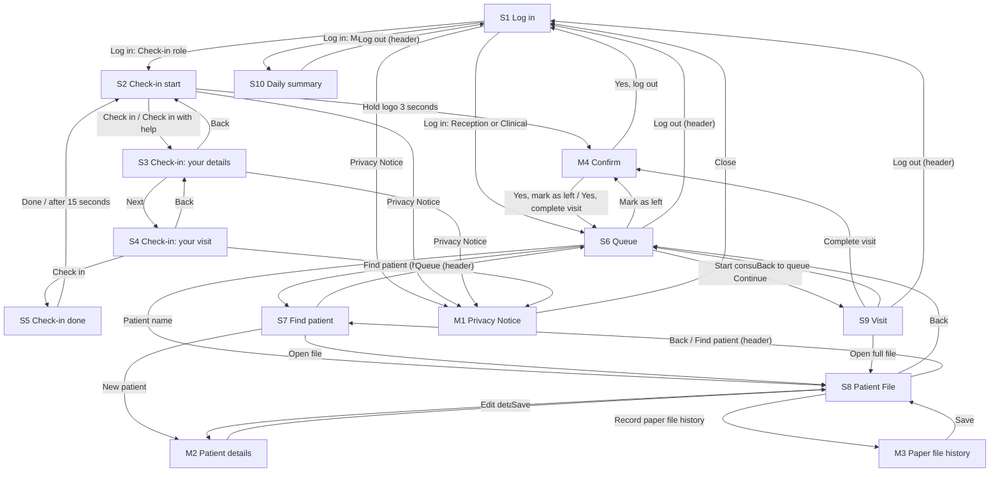

# IMPLEMENTATION_PLAN.md: Pholo CMS

---

## 0. Plan details

| Field | Value |
| --- | --- |
| App name | Pholo CMS (Clinic Management System) |
| Built from PRD version | v0.2 (approved: see Section 18, #3) |
| Screen designs | Stitch project with one screen per S# and M# in PRD 8.1. Link: to be added |
| Plan version | v1.1 |
| Repository | To be added |
| Status | Ready to build |
| Last updated | 03 Nov 2026 |

---

## 1. Start here (instructions for the coding agent)

Before writing any code:

1. Read this whole file from top to bottom.
2. Read `docs/PRD.md`.
3. Look at the screen designs listed in Section 7.3.
4. Check Section 18. If any clarification is still **Open**, stop and ask the human. Do not start.
5. Check that the prerequisites in Section 4.2 are installed.
6. Start **Phase 1 only**. Follow Section 2 at all times.

---

## 2. Rules for the coding agent (copy word for word, do not edit)

1. **One phase at a time.** Only work on the phase the human asked for. When that phase's Definition of Done is complete, stop and wait for the human to say "Start Phase <number>".
2. **Test-driven development (TDD) for every task.** Follow the cycle in Section 12.1:
    - Write the test.
    - Run it and see it fail for the right reason.
    - Write the smallest code that makes it pass.
    - Run all tests.
    - Refactor while all tests still pass.
3. **Never cheat a test.** Never delete, skip, weaken or change a test just to make it pass. If you believe a test is wrong, stop and explain why to the human.
4. **Never break earlier work.** Every test from earlier phases must still pass before a phase is done.
5. **Build only what is planned.** Build only what is in this file and `docs/PRD.md`. Never build anything in Section 3.3 (Deferred).
6. **Ask, don't guess.** If anything is missing, unclear or contradictory, stop, add it to Section 18, and ask the human.
7. **Match the designs.** Every screen must match its design in Section 7.3: layout, order, labels, text, colours and spacing. Use the design tokens in Section 7.1. Never hard-code colours, font sizes or spacing.
8. **Every state, every screen.** Each screen must handle every state listed for it in Section 7.3 (chosen from normal, empty, loading, error, offline, success, plus any screen-specific states).
9. **Exact wording.** Use the exact labels and messages from the PRD. Never invent wording.
10. **Security first.**
    - Never put secret keys in app code, logs, test files or Git.
    - Every permission rule in Section 9 must be enforced on the server or database, never only in the app.
    - Every permission rule must have a test.
11. **Full check before "done".** Run the full check command (Section 4.3) before saying a phase is done, then add a short summary of the results to the Progress log (Section 17).
12. **Record your progress.** After each phase:
    - tick the checkboxes for that phase in this file;
    - add a row to the Progress log;
    - commit using the commit message given in the phase.
13. **No surprise libraries.** Do not add, remove or upgrade any library or tool not listed in Section 4.1 without asking the human first.
14. **Stuck rule.** If the same problem is still failing after 3 attempts, stop and report:
    - what you tried;
    - the exact error;
    - what you need from the human.
15. **Clean code.** Follow the folder structure in Section 5. Use the PRD's key terms (Section 3.4) for names in code. Keep files small and focused.

---

## 3. Project summary and scope

### 3.1 Summary

Pholo CMS helps South African public clinics check in Patients on a tablet at the Facility entrance, so that waits shrink and paper files disappear. Patients (or a Door Assistant for them) check in and receive a Queue number; Reception and Clinical staff see one live Queue, call the next Patient and record each Visit in a digital Patient File; Managers see how many Patients came and how long they waited.

**Platform:** Web app that works in a browser. It runs on a tablet (the Check-in Tablet, designed and built first) and on clinic laptops or desktops (the staff screens). A Patient mobile app is a later phase (PRD 1.5).

### 3.2 Features in scope

| ID | Feature | Priority | Built in phase |
| --- | --- | --- | --- |
| F1 | Tablet Check-in | Must | 4 |
| F2 | Patient File | Must | 5 |
| F3 | Live Queue and calling | Must | 6 |
| F4 | Visit record | Must | 7 |
| F5 | Staff log-in and roles | Must | 3 |
| F6 | Daily summary | Should | 8 |
| F7 | Paper file digitisation | Should | 9 |

Phases 1 (Foundation), 2 (Data and security), 10 (Hardening) and 11 (Release) hold no feature of their own. The database rules for F1 to F7 are built in Phase 2.

### 3.3 Deferred: do NOT build

Non-goals (PRD 3.2):

- A Patient mobile app. The Check-in Tablet cuts the queue first; the app is a later phase (PRD 4.3).
- Appointment booking. Pholo CMS handles walk-in Patients only.
- Billing, medical aid claims and payments. The app has no prices.
- Offline mode. The app needs internet; the Facility uses a paper list during an outage.
- Screens in languages other than English. Translations are a future feature.
- Connections to national or provincial health information systems, labs or pharmacy stock.

Future features (PRD 4.3):

- A Patient mobile app (Expo) that shows the Patient's place in the Queue.
- Screens in isiZulu, Sesotho, Afrikaans and other official languages.
- A Check-in that keeps working during an internet or electricity cut.
- Queue priority for groups such as Patients aged 60 or over and babies under 1 year.
- Check-in on a staff computer for when the Check-in Tablet is down.

Also excluded by the PRD (stated as "not in v1", "none" or "later"):

- Admin screens: the administrator works in the Supabase dashboard (PRD 2.5).
- Patient sign-up, Patient accounts or Patient log-in (PRD Section 5).
- A Forgot password screen, profile editing, change of email or phone, and account deletion (PRD Section 5, 8.1).
- Delete screens for Patients or Visits (PRD 12.4).
- Email, SMS or push notifications (PRD 4.5).
- Dark mode, photos and illustrations (PRD 9.1).
- File or image storage and scheduled jobs (PRD 11.1).
- A merge tool for duplicate Patient Files (PRD 13.2: "a later feature").
- Public hosting of the app; it comes after v1 (PRD 11.1).
- Payments and SMS services (PRD 11.2).
- Provincial and district health officials as users (PRD 2.2).

### 3.4 Key terms (use these names in code)

| Term (PRD 1.7) | Name in code | Meaning |
| --- | --- | --- |
| Facility | `Facility`, table `facilities` | One public clinic that uses Pholo CMS. |
| Patient | `Patient`, table `patients` | A person who comes to the Facility for care. |
| Check-in | function `checkin`, audit action `checked_in`, API module `src/checkin/` | The moment a Patient (or the Door Assistant for them) records their arrival on the Check-in Tablet. It creates a Visit and gives a Queue number. |
| Check-in Tablet | role `Check-in` (one StaffProfile per tablet) | The tablet at the Facility entrance that shows the Check-in screens. |
| Door Assistant | column `visits.assisted` (Yes when "Check in with help" was used) | A staff member who stands at the entrance and does the Check-in for any Patient who cannot use the Check-in Tablet. They use the Check-in role. |
| Queue | not a table; the list of today's Visits with status Waiting, Called or In consultation; API module `src/queue/` | The ordered list of today's Visits that are not finished. |
| Patient File | a `patients` row with its `visits` | The digital record of one Patient: details, history from the paper file and all Visits. It replaces the paper folder. |
| Visit | `Visit`, table `visits` | One occasion on which a Patient comes to the Facility, from Check-in until the Visit is completed or the Patient leaves. |
| StaffProfile (PRD 10.1) | `StaffProfile`, table `staff_profiles` | One person (or one Check-in Tablet) that has a login. |
| AuditLog (PRD 10.1) | `AuditLog`, table `audit_logs` | One append-only line saying who did what and when (BR16). |

---

## 4. Tech stack, prerequisites and commands

### 4.1 Stack

| Layer | Tool | Version | Used for |
| --- | --- | --- | --- |
| Frontend | Next.js with React (`apps/web`) | Next.js 14, React 18 (latest 14.x at setup) | One web app that serves the Check-in Tablet screens and the staff screens |
| Language | TypeScript, npm workspaces, Node.js | TypeScript 5, Node.js 20 LTS | All code in `apps/web`, `apps/api` and `packages/types` |
| Styling | Tailwind CSS | 3 (latest 3.x at setup) | The design values in PRD Section 9 become Tailwind settings from one tokens file |
| Backend and database | Supabase PostgreSQL, as a hosted Supabase project used for development and tests with test data only | 15 | All tables, constraints, triggers, database functions and Row-Level Security |
| Authentication | Supabase Auth, email and password | Latest stable at setup | Log in for staff and Check-in Tablets; passwords never handled by our own code |
| Supabase client library | `@supabase/supabase-js` | Latest stable at setup | The web app's session, the API's calls with the user's token, and the database tests |
| Supabase command-line tool | Supabase CLI | Latest stable at setup | Applies `supabase/migrations` and `supabase/seed.sql` to the hosted development project; no Docker needed |
| Server functions | NestJS API (`apps/api`) | NestJS 10 on Node.js 20 LTS | Checks the access token and role, applies BR1 to BR19, calls Supabase with the user's token. The Check-in and AuditLog database functions are called with the service role key |
| Data fetching and caching | None. The web app asks the API for fresh data every 5 seconds on S6 and S10 (PRD 11.3) | Not applicable | Keeping the Queue and the summary up to date |
| File storage | None | Not applicable | v1 stores no files or images |
| Scheduled jobs | None | Not applicable | The end-of-day clean-up happens when S6 is opened (BR7) |
| Unit and component tests | Jest with React Testing Library and a jsdom test environment | Latest stable at setup | Business rules, helper functions, components and screens with fake data |
| Database and permission tests | Jest, using the Supabase client library signed in as each test account (the service role key is used only inside tests, read from `.env`) | Latest stable at setup | Constraints, triggers and permission rules |
| Integration tests | Jest with the NestJS testing tools and supertest, against the hosted development project | Latest stable at setup | Every backend operation in Section 10 |
| End-to-end tests | Manual walkthrough of the PRD 7.1 flows with the checklist in Section 15 (PRD 11.7 names no automated tool; kept manual, Section 18, #6) | Not applicable | Whole user flows on a real tablet and laptop |
| Lint and type check | ESLint and the TypeScript compiler (`tsc`) | Latest stable at setup (ESLint), TypeScript 5 | Static checks |
| Build and hosting | Developer laptop: `npm run dev` (web on port 3000, API on port 3001). The Check-in Tablet opens the laptop's address on the same Wi-Fi | Not applicable | Demo of every Must feature on a real device. Public hosting comes after v1 |
| Version control | GitHub | Not applicable | This plan and the PRD are saved in the repository |

### 4.2 Prerequisites on the computer

- [ ] Node.js 20 LTS with npm (npm workspaces)
- [ ] Git, with a GitHub account
- [ ] A Supabase account and a hosted project used only for development and tests with test data (URL and keys for `.env`; PRD 11.2)
- [ ] The Supabase command-line tool (no Docker needed)
- [ ] The latest Chrome or Edge on the laptop (PRD 12.1)
- [ ] A 10-inch Android tablet or an iPad with the latest Chrome or Safari, on the same Wi-Fi as the laptop (PRD 11.1, 12.1)

### 4.3 Commands

Every command is an npm script defined in the root `package.json` in Phase 1. The development backend is a hosted Supabase project (Section 18, #4), so there is nothing to start locally.

Before the full check: the hosted development project must be reset (`npm run db:reset`). The web and API dev servers do not need to be running; the tests start their own instance.

| Purpose | Command |
| --- | --- |
| Install dependencies | `npm install` |
| Start the local backend | Not needed: the hosted Supabase project is always running |
| Reset the database (migrations + seed data) | `npm run db:reset` (runs `supabase db reset --linked`: applies `supabase/migrations` in order, then `supabase/seed.sql`, to the linked development project) |
| Start the app | `npm run dev` (web on port 3000, API on port 3001) |
| Unit and component tests | `npm run test:unit` and `npm run test:component` |
| Database and permission tests | `npm run test:db` |
| Integration tests | `npm run test:int` |
| End-to-end tests | Manual: the checklist in Section 15 (PRD 11.7). No command |
| Lint | `npm run lint` |
| Type check | `npm run typecheck` |
| **Full check (run before every "done")** | `npm run check` (lint, type check, then `test:unit`, `test:component`, `test:db`, `test:int`) |
| Build for release | `npm run build` (builds `apps/web` and `apps/api`) |

---

## 5. Folder structure

The structure is PRD 11.6, with test folders added so every test level has a home.

```
pholo-cms/
  apps/
    api/                      NestJS API
      src/auth/               token check and role guard
      src/checkin/            Check-in function (BR1 to BR6, BR14, BR17)
      src/patients/           search, create, edit, paper file history
      src/queue/              Queue list, call next, mark as left
      src/visits/             start, save draft, complete
      src/summary/            daily summary (BR15)
      src/audit/              AuditLog writer (BR16)
      src/**/*.spec.ts        unit tests (next to the code they test)
      test/                   integration tests (against the hosted development project)
    web/                      Next.js app
      app/login/              S1
      app/checkin/            S2 (page.tsx), S3 (details/page.tsx), S4 (visit/page.tsx), S5 (done/page.tsx)
      app/queue/              S6
      app/patients/           S7 (page.tsx) and S8 ([id]/page.tsx)
      app/visits/[id]/        S9
      app/summary/            S10
      components/             shared components (Section 7.2) and the modals M1 to M4
      styles/                 design tokens (tokens.ts, Section 7.1)
      __tests__/              component and screen tests (components/ and screens/ inside)
  packages/
    types/                    shared TypeScript types and the shared rule checks (BR5, BR6, BR8, BR19)
      src/*.spec.ts           unit tests
  supabase/
    migrations/               database changes, in order (Section 8.6)
    seed.sql                  sample data (PRD 8.4)
    tests/                    database and permission tests
  docs/PRD.md                 the PRD
  IMPLEMENTATION_PLAN.md      this file
  .env.example                every variable in Section 6 with placeholder values
  README.md                   setup, commands, test accounts, how to run the tests
  package.json                npm workspaces
```

Screen to file map: S1 `apps/web/app/login`, S2 to S5 `apps/web/app/checkin`, S6 `apps/web/app/queue`, S7 and S8 `apps/web/app/patients`, S9 `apps/web/app/visits/[id]`, S10 `apps/web/app/summary`, M1 to M4 `apps/web/components`.

Where tests live: unit `packages/types/src` and `apps/api/src`; component `apps/web/__tests__`; database and permissions `supabase/tests`; integration `apps/api/test`.

**Rule:** a new folder may only be created if it is added to this section first.

---

## 6. Environment variables and secrets

| Name | What it is | Where to get it | Public or secret | Used by |
| --- | --- | --- | --- | --- |
| NEXT_PUBLIC_SUPABASE_URL | The address of the Supabase project, used by the web app to log in | Supabase dashboard, Project Settings, API | Public | Web app |
| NEXT_PUBLIC_SUPABASE_ANON_KEY | The key that lets the web app talk to Supabase; data is protected by RLS | Supabase dashboard, Project Settings, API | Public | Web app |
| NEXT_PUBLIC_API_URL | The address of the NestJS API. On the demo, the laptop's address on the Wi-Fi with port 3001 | Your own computer | Public | Web app |
| SUPABASE_URL | The address of the Supabase project, used by the API | Supabase dashboard, Project Settings, API | Public | API |
| SUPABASE_ANON_KEY | The key the API uses together with the user's token | Supabase dashboard, Project Settings, API | Public | API |
| SUPABASE_SERVICE_ROLE_KEY | The full-access key, used only by the API for the Check-in and AuditLog functions | Supabase dashboard, Project Settings, API | Secret | API and tests only |
| API_PORT | The port the API listens on (3001) | Your own choice | Public | API |
| WEB_ORIGIN | The web address that may call the API | Your own computer | Public | API |

`.env.example` (committed to Git, placeholder values only):

```
NEXT_PUBLIC_SUPABASE_URL=https://your-project.supabase.co
NEXT_PUBLIC_SUPABASE_ANON_KEY=your-anon-key
NEXT_PUBLIC_API_URL=http://your-laptop-wifi-ip:3001
SUPABASE_URL=https://your-project.supabase.co
SUPABASE_ANON_KEY=your-anon-key
SUPABASE_SERVICE_ROLE_KEY=your-service-role-key
API_PORT=3001
WEB_ORIGIN=http://your-laptop-wifi-ip:3000
```

Rules:

- Real values go in `.env`, which is listed in `.gitignore` and never committed.
- The Supabase project named in `.env` is used for development, tests and the demo and holds test data only: `npm run db:reset` wipes it.
- The root `.env` is loaded by the npm scripts with Node's built-in `--env-file` option, so no extra library is needed (Section 18, #5).
- The Check-in Tablet is a different device from the laptop, so the address the tablet opens and `NEXT_PUBLIC_API_URL` use the laptop's Wi-Fi IP address, not `127.0.0.1` (that would be the tablet itself).
- Secret values are never used in app code. They are used only in the API, scripts or integration and database tests, read from `.env`.
- If a new variable is needed, add it here and to `.env.example` first.

---

## 7. Design system and screens

### 7.1 Design tokens

All tokens live in `apps/web/styles/tokens.ts` and feed `tailwind.config`. Screens use tokens only. Values the PRD did not give were decided in Section 18, #19 and are marked Added below; add them to PRD 9.1.

| Token | Value | From PRD |
| --- | --- | --- |
| `color.primary` | #0F6E6E (clinic teal) | 9.1 Primary colour |
| `color.accent` | #9A4A00 (warm amber-brown, for Called badges and warnings) | 9.1 Secondary / accent colour |
| `color.background` | #F7FAFA (pages) | 9.1 |
| `color.surface` | #FFFFFF (cards) | 9.1 |
| `color.tint` | #E3F1F1 (light teal tint) | 9.1 |
| `color.text` / `color.textSecondary` | #1A2B2B / #4A5C5C | 9.1 |
| `color.error` / `color.success` / `color.warning` | #B42318 / #067647 / #9A4A00 | 9.1 |
| `color.errorBg` / `color.successBg` / `color.warningBg` | #FEF3F2 / #ECFDF3 / #FFF6E5 | 9.1 |
| `color.warningText` | #8A4B00 (warning text on its light background) | 9.1 |
| `color.greyBadgeBg` / `color.greyBadgeText` | #EDEFEF / #4A5C5C | 9.4 |
| `color.border` | #6B7B7B (text field border) | 9.1 (value chosen) |
| `color.borderLight` | #E3F1F1 (card border, same as the tint) | 9.1 (value chosen) |
| `color.disabledBg` / `color.disabledText` | #EDEFEF / #6B7B7B | 8.3 (value chosen) |
| `color.toastBg` / `color.toastText` | #1A2B2B / #FFFFFF | 8.3 (value chosen) |
| `color.backdrop` | #1A2B2B at 60% opacity (behind modals) | 8.3 (value chosen) |
| `color.skeleton` | #EDEFEF (loading blocks) | 8.3 (value chosen) |
| `color.badge.called` | fill #FFF6E5, text #8A4B00 | 8.3 (value chosen) |
| `font.family` | Atkinson Hyperlegible (fallback: system sans-serif) | 9.1 Font |
| `font.size.staff.title` | 28 px, weight 700 | 9.1 Text sizes |
| `font.size.staff.heading` | 20 px, weight 700 | 9.1 |
| `font.size.staff.body` | 16 px, weight 400 | 9.1 |
| `font.size.staff.small` | 14 px, weight 400 | 9.1 |
| `font.size.tablet.title` | 40 px, weight 700 | 9.1 |
| `font.size.tablet.heading` | 28 px, weight 700 | 9.1 |
| `font.size.tablet.body` | 22 px, weight 400 | 9.1 |
| `font.size.tablet.small` | 16 px, weight 400 | 9.1 |
| `font.size.tablet.button` | 24 px, weight 700 | 9.1 |
| `font.size.tablet.queueNumber` | 96 px, weight 700 | 9.1 |
| `space.1` to `space.4`, `space.6` | 8, 16, 24, 32, 48 px (unit 8 px) | 9.1 Spacing unit |
| `margin.staff` / `margin.tablet` | 24 px / 48 px | 9.1 Screen side margin |
| `radius.card` / `radius.input` / `radius.button` / `radius.badge` | 12 px / 8 px / 12 px / pill (fully rounded) | 9.1 Corner radius |
| `shadow.card` | 0 1px 3px rgba(0,0,0,0.12), cards only | 9.1 Shadows |
| `size.button.staff` / `size.button.tablet` | 48 px / 72 px | 9.1 Button height |
| `size.touchMin` | 44 px (44 x 44 px) | 9.4 |
| `size.contentMax.staff` / `size.contentMax.tablet` | 1200 px / 960 px (centred) | 9.3 |
| `focus.outline` | 3 px teal outline with a 2 px gap | 9.3 |
| `hover.darken` | 10% darker | 9.3, 8.3 |
| `breakpoint.phone` / `breakpoint.tablet` / `breakpoint.desktop` | under 640 px / 640 to 1024 px / over 1024 px | 9.3 |
| `frame.tablet` / `frame.staff` | 1280 x 800 px landscape / 1440 x 900 px | 9.3 Design first |
| `toast.durationMs` | 3000 | 8.3 Toast |
| `icon.set` | Lucide, outline style | 9.1 |

### 7.2 Shared components

Each component lives in `apps/web/components/` and has its test in `apps/web/__tests__/components/`.

| Component | File | Variants and states | Used on | Tests |
| --- | --- | --- | --- | --- |
| Staff Header | `components/StaffHeader.tsx` | Links by role (Queue and Find patient for Reception and Clinical, Summary for Manager); active link has a 3 px teal underline; links 44 px tall; initials circle, name and role in small text; "Log out" button goes to S1 | S6, S7, S8, S9, S10 | T-C-1 |
| Check-in Header | `components/CheckinHeader.tsx` | Logo, facility name, date and time; "Step 1 of 2" or "Step 2 of 2" on S3 and S4; no menu; press and hold the logo for 3 seconds on S2 opens M4 | S2, S3, S4, S5 | T-C-2 |
| Primary button | `components/Button.tsx` (variant `primary`) | Teal fill, white text; hover and press darken 10%; disabled grey with grey text; 48 px (72 px on the Check-in Tablet); loading label | All screens | T-C-3 |
| Secondary button | `components/Button.tsx` (variant `secondary`) | White fill, teal border and text; hover fills with the light teal tint; disabled grey | All screens | T-C-4 |
| Danger button | `components/Button.tsx` (variant `danger`) | Red fill, white text; only for actions that cannot be undone | M4 | T-C-5 |
| Text field | `components/TextField.tsx` | Label above, field, error text below; normal grey border; focused 3 px teal outline; error red border plus red message and error icon; long-text and password (Show / Hide) variants | S1, S3, S7, S9, M2, M3 | T-C-6 |
| Choice button | `components/ChoiceButton.tsx` | Large button with text; selected teal fill, white text and tick icon; not selected white with teal border | S3, S4 | T-C-7 |
| Dropdown | `components/Dropdown.tsx` | Label, closed field with a down arrow, list of options; same looks as the Text field | S9, M2 | T-C-8 |
| Checkbox | `components/Checkbox.tsx` | 32 px square box and a label; ticked shows a tick icon; error shows a red border and the message | S4, M3 | T-C-9 |
| Card | `components/Card.tsx` | White background, light border, soft shadow; not clickable unless it holds a button or link | S5, S6, S7, S8, S10 | T-C-10 |
| Status badge | `components/StatusBadge.tsx` | Waiting light teal fill, dark text; Called light amber fill, brown text; In consultation teal fill, white text; Completed light green fill, green text; Left light grey fill, grey text; Urgent red fill, white text; paper file status grey fill; always a word | S6, S7, S8 | T-C-11 |
| Toast | `components/Toast.tsx` | Short message in a dark bar at the bottom; disappears after 3 seconds | S6, S8, S9 | T-C-12 |
| Confirmation pop-up | `components/ConfirmModal.tsx` (M4) | Title, text, cancel button left, confirm button right; Loading and Error and Offline variants | S2, S6, S9 | T-C-13 |
| Empty-state block | `components/EmptyState.tsx` | Icon, message, and a button when there is something to do; centred in the list area | S6, S7, S8, S10 | T-C-14 |
| Loading placeholder | `components/LoadingPlaceholder.tsx` | Grey blocks the shape of the real content; soft pulse; no spinner on its own | S6, S7, S8, S9, S10 | T-C-15 |
| Offline banner | `components/OfflineBanner.tsx` | Full-width amber bar at the top with an icon and the offline text; shows while there is no internet and disappears by itself when it is back | All screens | T-C-16 |

### 7.3 Screens

Design names refer to the Stitch screen with the same ID and name (project link: to be added). The "Main screen" of a role is S2 for Check-in, S6 for Reception and Clinical, S10 for Manager. Any role that opens a screen it may not open sees "You are not allowed to open this page." and goes to its main screen (PRD 12.2). A logged-out visitor goes to S1. The not-allowed message shows as a toast on the main screen; "Your session has ended. Please log in again." shows in the error area of S1 (Section 18, #22). S9 opens only for a Visit that is In consultation: a Waiting or Called Visit sends the user to S6 and a Completed or Left Visit to S8 of that Patient, with no message (Section 18, #23).

| ID | Screen | Route / file | Design | Who can open it (else redirect to) | Tab bar | Required states | Phase |
| --- | --- | --- | --- | --- | --- | --- | --- |
| S1 | Log in | `/login`, `app/login/page.tsx` | Stitch screen S1 Log in | Logged out (else the user's main screen) | No (no header) | Normal, Loading, Error (server problem, wrong details, too many tries), Offline, Field errors. Empty not needed; Success has no message | 1 (layout), 3 (log-in) |
| S2 | Check-in start | `/checkin`, `app/checkin/page.tsx` | Stitch screen S2 Check-in start | Logged in: Check-in (else S1, or the not-allowed message and the main screen) | No | Normal, Offline. Empty, Loading, Error, Success not needed | 4 |
| S3 | Check-in: your details | `/checkin/details`, `app/checkin/details/page.tsx` | Stitch screen S3 Check-in: your details | Logged in: Check-in | No | Normal, Empty, Offline, Field errors. Loading, Error, Success not needed | 4 |
| S4 | Check-in: your visit | `/checkin/visit`, `app/checkin/visit/page.tsx` | Stitch screen S4 Check-in: your visit | Logged in: Check-in | No | Normal, Empty, Loading, Error (server problem, limit reached), Offline, Field errors. Success goes to S5 | 4 |
| S5 | Check-in done | `/checkin/done`, `app/checkin/done/page.tsx` | Stitch screen S5 Check-in done | Logged in: Check-in | No | Normal (this is the success state), Urgent variant, Already checked in variant. Empty, Loading, Error, Offline not needed | 4 |
| S6 | Queue | `/queue`, `app/queue/page.tsx` | Stitch screen S6 Queue | Logged in: Reception, Clinical (else the main screen) | No (Staff Header links) | Normal (Clinical and Reception views), Empty, Loading, Error, Offline, Success (toasts), Call next patient disabled | 6 |
| S7 | Find patient | `/patients`, `app/patients/page.tsx` | Stitch screen S7 Find patient | Logged in: Reception, Clinical | No (Staff Header links) | Normal, Empty (before a search, no results; Reception and Clinical differ), Loading, Error, Offline, Field error. Success not needed | 5 |
| S8 | Patient File | `/patients/[id]`, `app/patients/[id]/page.tsx` | Stitch screen S8 Patient File | Logged in: Reception, Clinical | No (Staff Header links) | Normal (Reception and Clinical views), Empty (no visits), Loading, Error, Offline, Success (toasts) | 5 (basic), 7 (Clinical details), 9 (paper file history) |
| S9 | Visit | `/visits/[id]`, `app/visits/[id]/page.tsx` | Stitch screen S9 Visit | Logged in: Clinical (Reception goes to S6 with the not-allowed message) | No (Staff Header links) | Normal, Loading, Error, Offline, Success (toast, then S6), Field errors. Empty not needed | 7 |
| S10 | Daily summary | `/summary`, `app/summary/page.tsx` | Stitch screen S10 Daily summary | Logged in: Manager | No (Staff Header links) | Normal, Empty, Loading, Error, Offline. Success not needed | 8 |
| M1 | Privacy Notice | `components/PrivacyNoticeModal.tsx` | Stitch screen M1 Privacy Notice | Logged out (from S1), Logged in: Check-in (from S2, S3, S4) | No | Normal. All other states not needed | 4 |
| M2 | Patient details | `components/PatientDetailsModal.tsx` | Stitch screen M2 Patient details | Logged in: Reception (create and edit), Clinical (edit) | No | Normal (edit), Empty (create), Loading, Error, Offline, Success, Field errors including the duplicate ID number | 5 |
| M3 | Paper file history | `components/PaperFileHistoryModal.tsx` | Stitch screen M3 Paper file history | Logged in: Reception, Clinical | No | Normal, Empty, Loading, Error, Offline, Success, Field errors | 9 |
| M4 | Confirm | `components/ConfirmModal.tsx` | Stitch screen M4 Confirm (four versions) | Logged in: Check-in (log out only), Reception, Clinical | No | Normal, Loading, Error, Offline. Empty and Success not needed. Versions: Mark as left (Phase 6), Complete visit and Leave without saving (Phase 7), Log out of this tablet (Phase 4); the four texts and buttons are built and tested in Phase 3 | 3 |

---

## 8. Data model and database

### 8.1 Tables

All times are `timestamptz` stored in UTC and shown in SAST (BR19). Choice values are written exactly as in the PRD.

**Table: `facilities`**: one public clinic that uses Pholo CMS

| Column | Type | Null? | Default | Constraints | Notes |
| --- | --- | --- | --- | --- | --- |
| id | uuid | No | gen_random_uuid() | primary key | |
| name | text | No | none | unique; check length 1 to 100 | |
| address | text | No | none | check length 1 to 200 | |
| province | text | No | none | check in (Eastern Cape, Free State, Gauteng, KwaZulu-Natal, Limpopo, Mpumalanga, Northern Cape, North West, Western Cape) | |
| created_at | timestamptz | No | now() | | BR19 |

**Table: `staff_profiles`**: one person or one Check-in Tablet that has a login

| Column | Type | Null? | Default | Constraints | Notes |
| --- | --- | --- | --- | --- | --- |
| id | uuid | No | the login user's id | primary key; foreign key → auth.users (id) | Same value as the Supabase Auth user id |
| facility_id | uuid | No | none | foreign key → facilities (id) on delete restrict | |
| full_name | text | No | none | check length 1 to 80 | |
| role | text | No | none | check in (Check-in, Reception, Clinical, Manager) | |
| active | boolean | No | true | | No means the person can no longer log in |
| created_at | timestamptz | No | now() | | |

**Table: `patients`**: one person who has a Patient File at a Facility

| Column | Type | Null? | Default | Constraints | Notes |
| --- | --- | --- | --- | --- | --- |
| id | uuid | No | gen_random_uuid() | primary key | |
| facility_id | uuid | No | none | foreign key → facilities (id) on delete restrict | |
| file_number | text | No | next number at this Facility (trigger) | unique (facility_id, file_number); check matches `PH-` followed by 6 digits; never changes (trigger) | BR4. Example PH-000123 |
| first_name | text | No | none | check length 1 to 40; letters, spaces, hyphens and apostrophes only | S3, M2 |
| surname | text | No | none | check length 1 to 40; letters, spaces, hyphens and apostrophes only | S3, M2 |
| date_of_birth | date | No | none | check not before 1 Jan 1900; not in the future (trigger) | S3, M2 |
| id_number | text | Yes | none | unique (facility_id, id_number) where not null; check 13 digits, first 6 equal the date of birth as YYMMDD, last digit passes the Luhn test | BR5 |
| cellphone | text | Yes | none | check `+27` followed by 9 digits | BR6 |
| paper_file_status | text | No | No paper file | check in (No paper file, Paper file - not yet digitised, Paper file - digitised); "digitised" only under BR18 (trigger) | BR4, BR18 |
| chronic_conditions | text | Yes | none | check length up to 500 | |
| allergies | text | Yes | none | check length up to 300 | |
| current_medication | text | Yes | none | check length up to 500 | |
| created_at | timestamptz | No | now() | | |
| updated_at | timestamptz | No | now() | set again on every change (trigger) | |

**Table: `visits`**: one occasion on which a Patient comes to the Facility

| Column | Type | Null? | Default | Constraints | Notes |
| --- | --- | --- | --- | --- | --- |
| id | uuid | No | gen_random_uuid() | primary key | |
| facility_id | uuid | No | none | foreign key → facilities (id) on delete restrict | |
| patient_id | uuid | No | none | foreign key → patients (id) on delete restrict | |
| queue_number | integer | No | next number for the Facility and day | check 1 or more; unique per facility and per SAST day of checkin_at | BR1 |
| checkin_at | timestamptz | No | now() | | |
| reason_category | text | No | none | check in (Feeling sick or injured, Collecting medication, Baby or child care, Pregnancy or family planning, Test or screening, Something else) | |
| urgent | boolean | No | false | | |
| assisted | boolean | No | false | | Yes when "Check in with help" was used |
| consent_given | boolean | No | none | check must be true | BR17 |
| status | text | No | Waiting | check in (Waiting, Called, In consultation, Completed, Left); changes only as in Section 8.3 | BR7, BR9 |
| called_at | timestamptz | Yes | none | | Set when the Visit becomes Called |
| called_by | uuid | Yes | none | foreign key → staff_profiles (id) on delete restrict | The Clinical user who called it |
| started_at | timestamptz | Yes | none | | Set when the Visit becomes In consultation |
| clinician | uuid | Yes | none | foreign key → staff_profiles (id) on delete restrict | The Clinical user who started it |
| completed_at | timestamptz | Yes | none | | Set when the Visit becomes Completed |
| left_at | timestamptz | Yes | none | | Set when the Visit becomes Left, by a user or by the next-day clean-up. Added by Section 18, #13 |
| symptoms | text | Yes | none | check length 1 to 1000 when filled in | Required to complete (BR8) |
| notes | text | Yes | none | check length up to 2000 | BR8 |
| icd10_codes | text | Yes | none | check length up to 60; up to 5 codes separated by commas, each a capital letter, two digits, and optionally a dot with 1 or 2 letters or digits | BR8 |
| outcome | text | Yes | none | check in (Treated and sent home, Medication given, Referred to hospital, Follow-up needed, Other) | Required to complete (BR8) |
| created_at | timestamptz | No | now() | | |

Also: a Completed Visit must have symptoms and outcome filled in (BR8, check). At most one Visit per Patient may have status Waiting, Called or In consultation (unique partial index; BR3).

**Table: `audit_logs`**: one line saying who did what and when; append-only (BR16)

| Column | Type | Null? | Default | Constraints | Notes |
| --- | --- | --- | --- | --- | --- |
| id | uuid | No | gen_random_uuid() | primary key | |
| facility_id | uuid | No | none | foreign key → facilities (id) on delete restrict | |
| actor_id | uuid | No | none | foreign key → staff_profiles (id) on delete restrict | The login that did the action (the tablet's login for a Check-in) |
| action | text | No | none | check in (checked_in, opened_patient_file, created_patient, updated_patient, recorded_paper_history, called_next, started_consultation, saved_draft, completed_visit, marked_left, corrected_visit) | BR16, Section 18, #15 | BR16 |
| entity_type | text | No | none | check in (Patient, Visit) | |
| entity_id | uuid | No | none | | The id of the Patient or Visit |
| created_at | timestamptz | No | now() | | |

### 8.2 Relationships and delete behaviour

- `staff_profiles.facility_id`, `patients.facility_id`, `visits.facility_id`, `audit_logs.facility_id` → `facilities.id`, on delete restrict (block the delete).
- `visits.patient_id` → `patients.id`, on delete restrict.
- `visits.called_by` and `visits.clinician` → `staff_profiles.id`, on delete restrict.
- `audit_logs.actor_id` → `staff_profiles.id`, on delete restrict.
- `staff_profiles.id` → `auth.users.id` (same value).
- No two tables link many-to-many, so there is no middle table (PRD 10.2).
- Accounts are disabled (`active` = false), never deleted (PRD Section 5).

### 8.3 Status changes

| Table.column | From | To | Triggered by | Enforced by |
| --- | --- | --- | --- | --- |
| visits.status | (new) | Waiting | A Check-in is saved (BR1, BR3) | database function `checkin` |
| visits.status | Waiting | Called | A Clinical user taps "Call next patient" (BR2) | database function `call_next_patient`; trigger `visits_guard` |
| visits.status | Called | In consultation | A Clinical user taps "Start consultation" | trigger `visits_guard` (Clinical only) |
| visits.status | In consultation | Completed | A Clinical user taps "Yes, complete visit" in M4 (BR8) | trigger `visits_guard`; check on symptoms and outcome |
| visits.status | Waiting or Called | Left | A Reception or Clinical user taps "Yes, mark as left" in M4 | trigger `visits_guard` (sets left_at) |
| visits.status | Waiting, Called or In consultation | Left | Automatic, when an earlier day's Visit is found open (BR7); left_at is set and AuditLog `marked_left` is written for the user who opened S6 | database function `close_stale_visits` (sets left_at) |
| patients.paper_file_status | (new) | No paper file | Check-in answer "No" (BR4), or chosen in M2 | database function `checkin`; check |
| patients.paper_file_status | (new) | Paper file - not yet digitised | Check-in answer "Yes" (BR4), or chosen in M2 | database function `checkin`; check |
| patients.paper_file_status | Paper file - not yet digitised | Paper file - digitised | Reception or Clinical saves M3 with the box ticked (BR18) | trigger `patients_guard` |
| staff_profiles.active | true | false | The administrator disables the account in the Supabase dashboard | Done by the administrator, not in the app |
| staff_profiles.active | false | true | The administrator enables the account again | Done by the administrator, not in the app |

Any other status change is refused: nothing leaves Completed or Left (BR9), and nothing moves backwards. The only exception is the administrator function `admin_correct_visit` (Section 18, #15).

### 8.4 Indexes

- `patients (facility_id, lower(surname), lower(first_name))` for search by name and the sort order of BR13.
- `patients (facility_id, lower(first_name), lower(surname), date_of_birth)` for the name and date of birth match in BR4.
- `patients (facility_id, id_number)` unique where not null, for the ID number match (BR4, BR5, BR13).
- `patients (facility_id, file_number)` unique, for file number search and for the next file number.
- `visits (facility_id, status, checkin_at)` for the Queue (BR2).
- `visits (patient_id, checkin_at desc)` for the Visits section of S8.
- `visits (facility_id, queue_number, (SAST day of checkin_at))` unique, for BR1.
- `visits (patient_id)` unique where status is Waiting, Called or In consultation, for BR3.
- `visits (facility_id, checkin_at)` for the daily summary (BR15).
- `audit_logs (actor_id, action, created_at desc)` for the 40-in-10-minutes limit (BR14).

### 8.5 Automatic jobs and triggers

There are no scheduled jobs (PRD 11.1). The end-of-day clean-up runs when S6 is opened (BR7, operation OP5).

| Name | Runs when | What it does | BR# | Test |
| --- | --- | --- | --- | --- |
| `patients_set_file_number` | Before insert on patients | Gives the next file number at the Facility (PH- and 6 digits) | BR4 | T-DB-5 |
| `patients_guard` | Before insert or update on patients | Refuses a date of birth in the future; refuses a changed file_number; refuses "Paper file - digitised" unless it comes from "not yet digitised" and at least one history field is filled in | BR18 | T-DB-4, T-BR18-1 to T-BR18-4 |
| `patients_set_updated_at` | Before update on patients | Sets updated_at to now() | | T-DB-9 |
| `visits_guard` | Before update or delete on visits | Allows only the status changes in Section 8.3, by the roles allowed; refuses every change to a Completed Visit except through `admin_correct_visit`; refuses delete | BR7, BR9 | T-BR7-4, T-BR7-5, T-BR9-1, T-BR9-2 |
| `audit_logs_append_only` | Before update or delete on audit_logs | Refuses every update and delete | BR16 | T-BR16-11 |

### 8.6 Migrations (in order)

1. `20261103000100_create_facilities_and_staff_profiles.sql`: tables `facilities` and `staff_profiles` with their constraints.
2. `20261103000200_create_patients.sql`: table `patients`, `is_valid_sa_id`, `normalise_cellphone`, `next_file_number`, trigger `patients_set_file_number`.
3. `20261103000300_create_visits.sql`: table `visits` with its constraints and unique indexes.
4. `20261103000400_create_audit_logs.sql`: table `audit_logs` and trigger `audit_logs_append_only`.
5. `20261103000500_create_indexes.sql`: the remaining indexes in Section 8.4.
6. `20261103000600_create_guards.sql`: triggers `patients_guard`, `patients_set_updated_at`, `visits_guard`.
7. `20261103000700_create_functions.sql`: `write_audit`, `checkin`, `call_next_patient`, `close_stale_visits`, `daily_summary`, `admin_correct_visit`.
8. `20261103000800_create_reception_visits_view.sql`: view `visits_for_reception` (a Visit without symptoms, notes, icd10_codes and outcome).
9. `20261103000900_enable_rls_and_policies.sql`: Row-Level Security on every table, the policies in Section 9, and the function permissions.

### 8.7 Seed data and test accounts

- **Seed file:** `supabase/seed.sql`. It loads the sample data set from PRD 8.4: 1 Facility (Ubuntu Community Clinic, 12 Vilakazi Street, Soweto, Johannesburg, Gauteng), 4 staff with logins, 4 Patients (PH-000001 to PH-000004) and 4 Visits. The Visits get today's date (SAST) at seed time with the PRD 8.4 times, so run `npm run db:reset` before each demo day (BR7 sets earlier days' open Visits to Left). Visits 1 and 2 have Nomsa Khumalo as called_by and clinician. Joseph Mokoena has chronic conditions "Hypertension", allergies "Penicillin" and current medication "Amlodipine 5 mg once a day"; Sipho Nkosi has no history (Section 18, #11, #12).
- **Test accounts:** one per role: Check-in `tablet1@ubuntu-clinic.example`, Reception `busisiwe.naidoo@ubuntu-clinic.example`, Clinical `nomsa.khumalo@ubuntu-clinic.example`, Manager `farouk.patel@ubuntu-clinic.example`. The test-only password is in PRD 10.4 and in the README. Never write it in this file.

---

## 9. Security and permissions

Every rule has two tests: **a** (the permitted actor can) and **b** (anyone else cannot). For rules that say "nobody in the app", **a** proves the administrator path (the service role key, as the dashboard does) works and **b** proves every app role is refused. Tests need a second Facility, created inside the test by the service role.

| ID | Table / resource | Action | Who is allowed | Rule | Enforced by | Tests (allow / deny) |
| --- | --- | --- | --- | --- | --- | --- |
| SEC1 | facilities | read | Every logged-in role, own Facility only | Only the name is shown | policy `facilities_select_own` | T-SEC-1a / T-SEC-1b |
| SEC2 | facilities | create, update, delete | Nobody in the app | The administrator uses the Supabase dashboard | no policy for these actions | T-SEC-2a / T-SEC-2b |
| SEC3 | staff_profiles | read | Each user reads their own row; Reception and Clinical read the full_name of staff linked to Visits they can see | Nothing else | policy `staff_profiles_select` | T-SEC-3a / T-SEC-3b |
| SEC4 | staff_profiles | create, update, delete | Nobody in the app | Accounts are disabled, never deleted | no policy for these actions | T-SEC-4a / T-SEC-4b |
| SEC5 | patients | read | Reception, Clinical (own Facility) | Check-in and Manager never read Patients | policy `patients_select_reception_clinical` | T-SEC-5a / T-SEC-5b |
| SEC6 | patients | create | Reception (M2); the Check-in role only through the Check-in function | Clinical cannot create a Patient File. BR4, BR5 | policy `patients_insert_reception`; function `checkin` | T-SEC-6a / T-SEC-6b |
| SEC7 | patients | update | Reception, Clinical (own Facility) | file_number never changes | policy `patients_update_reception_clinical`; trigger `patients_guard` | T-SEC-7a / T-SEC-7b |
| SEC8 | patients | update paper_file_status to "Paper file - digitised" | Reception, Clinical | Only when at least one of chronic conditions, allergies or current medication is filled in (BR18) | trigger `patients_guard` | T-SEC-8a / T-SEC-8b |
| SEC9 | patients | delete | Nobody in the app | The administrator deletes only on request, after the retention periods in PRD 12.4 | no policy for this action | T-SEC-9a / T-SEC-9b |
| SEC10 | visits | read (all fields) | Clinical (own Facility) | | policy `visits_select_clinical` | T-SEC-10a / T-SEC-10b |
| SEC11 | visits | read without symptoms, notes, ICD-10 codes and outcome | Reception, through the view | Reception can never read those four columns | view `visits_for_reception`; no direct select policy for Reception | T-SEC-11a / T-SEC-11b |
| SEC12 | visits | read | Check-in and Manager: never | The Manager sees counts only, through `daily_summary` | no select policy for these roles | T-SEC-12a / T-SEC-12b |
| SEC13 | visits | create | The Check-in function only | BR1, BR3, BR14, BR17 | function `checkin` (no insert policy for any role) | T-SEC-13a / T-SEC-13b |
| SEC14 | visits | update: call next, start, save draft, complete | Clinical | | policy `visits_update_clinical`; trigger `visits_guard` | T-SEC-14a / T-SEC-14b |
| SEC15 | visits | update: mark as Left | Reception, Clinical | Only from Waiting or Called (BR7) | policy `visits_update_left`; trigger `visits_guard` | T-SEC-15a / T-SEC-15b |
| SEC16 | visits | update after status Completed | Nobody in the app; the administrator only through `admin_correct_visit` | BR9 | trigger `visits_guard` | T-SEC-16a / T-SEC-16b |
| SEC17 | visits | delete | Nobody in the app | | no policy for this action; trigger `visits_guard` | T-SEC-17a / T-SEC-17b |
| SEC18 | audit_logs | create | The API and database functions, for every action in BR16 | No user writes a row directly | function `write_audit` (execute only for the service role); no insert policy | T-SEC-18a / T-SEC-18b |
| SEC19 | audit_logs | read | Nobody in the app | The administrator reads it in the Supabase dashboard | no select policy | T-SEC-19a / T-SEC-19b |
| SEC20 | audit_logs | update, delete | Nobody, ever | Append-only (BR16) | trigger `audit_logs_append_only` | T-SEC-20a / T-SEC-20b |
| SEC21 | Check-in operation (OP4) | execute | Check-in role only | The Check-in account has no way to read Patients, Visits or the Queue. Reception, Clinical and Manager cannot check in | API role guard; function `checkin` executable only by the service role | T-SEC-21a / T-SEC-21b |
| SEC22 | Daily summary (OP17) | execute | Manager only | Counts and averages only; no Patient name | API role guard; function `daily_summary` | T-SEC-22a / T-SEC-22b |
| SEC23 | Call next, Start consultation, Save draft, Complete visit, Get Visit (OP6, OP7, OP14, OP15, OP16) | execute | Clinical only | Reception cannot call a Patient, start or complete a Visit | API role guard | T-SEC-23a / T-SEC-23b |
| SEC24 | Queue list, Patient search, Patient File, Create patient, Update patient, Record paper history, Mark as left (OP5, OP8 to OP13) | execute | Reception and Clinical (Create patient: Reception only) | Check-in and Manager are refused | API role guard | T-SEC-24a / T-SEC-24b |
| SEC25 | All tables | read, write | Each user reaches rows of their own Facility only | | every policy includes the user's facility | T-SEC-25a / T-SEC-25b |
| SEC26 | All operations and tables | any | Only a StaffProfile with active = true | A disabled account can no longer use the app | API guard and policies check `active` | T-SEC-26a / T-SEC-26b |

**Always-on security checks** (tested in the hardening phase):

- [ ] Every table has permission rules switched on (RLS enabled). There is a test that fails if any table has none (T-DB-17, run again in Phase 10).
- [ ] Input is checked in the app **and** on the server or database (T-INT-17).
- [ ] Rate limits from the PRD are enforced on the server: BR12 (log-in goes through the API, Section 18, #8) and BR14.
- [ ] File uploads check type and size before upload and again on the server: not applicable, because v1 has no file or image uploads (PRD 11.1).
- [ ] No passwords, tokens or personal data are written to logs (T-INT-18).
- [ ] A secret scan of the repository finds no keys (T-SETUP-7, T-REL-5).

---

## 10. Backend operations

Every operation is a NestJS module function (folder in Section 5) that checks the token, the role and `active` first (SEC21 to SEC26). "Database function" means a Postgres function from migration 7. Error messages are exact (PRD 12.2). The route names are chosen by the agent and are not part of the plan; tests refer to the OP number. In every operation, when the token is missing or expired the error is "Your session has ended. Please log in again." and when the role is wrong it is "You are not allowed to open this page.".

| ID | Operation | Who can call it | Input | Output | Rules | Errors (exact message) | Built as | Tests |
| --- | --- | --- | --- | --- | --- | --- | --- | --- |
| OP1 | Log in | Logged out | email, password | Session; the user's role | BR12 | "Email or password is not correct. Try again." · "Too many tries. Wait 60 seconds and try again." · "Something went wrong on our side. Please try again." | `src/auth/` log-in function that calls Supabase Auth and keeps the count of wrong passwords per email in the API's memory (5 wrong in a row lock that email for 60 seconds); the web app keeps the returned session (Section 18, #8) | T-US11-1 to T-US11-3, T-BR12-1 to T-BR12-4 |
| OP2 | Log out | Any logged-in user | none | Session ended, user goes to S1 | BR11 | "Something went wrong on our side. Please try again." | Supabase Auth from the browser | T-AUTH-9 |
| OP3 | Read my profile and Facility name | Any logged-in user | none | role, full_name, Facility name | SEC1, SEC3, SEC26 | "Your session has ended. Please log in again." | `src/auth/` using the user's token | T-INT-1, T-SEC-1a, T-SEC-3a |
| OP4 | Check-in | Check-in | first_name, surname, date_of_birth, id_number (optional), cellphone (optional), has_file (Yes or No), assisted, reason_category, urgent, consent_given | queue_number; already_checked_in; urgent; has_file. Nothing stored about the Patient comes back | BR1, BR3, BR4, BR5, BR6, BR14, BR16, BR17 | The field messages of S3 and S4 · "Too many Check-ins at once. Please wait one minute and try again." · "Something went wrong on our side. Please try again." | `src/checkin/` calling database function `checkin` (service role key) | T-US1-1 to T-US1-3, T-US2-1, T-US3-1, T-BR1-1 to T-BR1-5, T-BR3-1 to T-BR3-5, T-BR4-1 to T-BR4-8, T-BR14-1 to T-BR14-5, T-BR17-1 to T-BR17-3, T-INT-2 |
| OP5 | List Queue (Active and Done today, with counts) | Reception, Clinical | tab (Active or Done today) | Rows in BR2 order; counts for Waiting, In consultation, Completed; Reception rows without clinical fields. First sets earlier days' open Visits to Left | BR2, BR7, BR16 | "We could not load the queue. Please try again." | `src/queue/`; calls `close_stale_visits`, then reads (Reception through `visits_for_reception`) with the user's token | T-US7-1, T-BR2-4, T-BR7-6, T-INT-3 |
| OP6 | Call next patient | Clinical | none | The Visit now Called (queue_number, patient name) or "none waiting" | BR2, BR16 | "No one is waiting." is shown on S6 · "Something went wrong on our side. Please try again." | `src/queue/` calling database function `call_next_patient` | T-US6-1, T-US6-2, T-BR2-1 to T-BR2-3, T-EDGE-4 |
| OP7 | Start consultation | Clinical | visit id | The Visit now In consultation | BR7, BR16 | "Something went wrong on our side. Please try again." | `src/visits/`, update with the user's token under policy and `visits_guard` | T-INT-4, T-SEC-14a |
| OP8 | Mark as left | Reception, Clinical | visit id | The Visit now Left | BR7, BR16 | "Something went wrong on our side. Please try again." | `src/queue/`, update with the user's token under policy and `visits_guard` | T-US8-1, T-US8-2, T-EDGE-5 |
| OP9 | Search patients | Reception, Clinical | search text | Up to 20 Patients (name, date of birth, file number, last 4 digits of ID number, paper file status) | BR13 | "Type at least 2 characters to search." · "Search did not work. Please try again." | `src/patients/` select with the user's token | T-US4-1, T-US4-2, T-BR13-1 to T-BR13-6 |
| OP10 | Get Patient File | Reception, Clinical | patient id | Patient details, history, Visits newest first (Reception: date, reason, status only) | BR16, SEC11 | "We could not open this file. Please try again." | `src/patients/`; select with the user's token, then `write_audit` (`opened_patient_file`) | T-US12-1, T-INT-5, T-BR16-2 |
| OP11 | Create patient | Reception | first_name, surname, date_of_birth, id_number, cellphone, paper_file_status | The new Patient | BR4, BR5, BR6, BR16 | The M2 field messages · "A patient with this ID number already exists. Open their file instead." | `src/patients/`; insert with the user's token; trigger `patients_set_file_number`; `write_audit` (`created_patient`) | T-US14-1, T-US14-2, T-INT-6 |
| OP12 | Update patient details | Reception, Clinical | patient id, first_name, surname, date_of_birth, id_number, cellphone | The updated Patient | BR5, BR6, BR16 | The M2 field messages · "A patient with this ID number already exists. Open their file instead." | `src/patients/`; update with the user's token; `write_audit` (`updated_patient`) | T-US5-1, T-US5-2, T-INT-7 |
| OP13 | Record paper file history | Reception, Clinical | patient id, chronic_conditions, allergies, current_medication, mark_digitised | The updated Patient | BR18, BR16 | The M3 field messages | `src/patients/`; update with the user's token; trigger `patients_guard`; `write_audit` (`recorded_paper_history`) | T-US15-1, T-US15-2, T-BR18-1 to T-BR18-4 |
| OP14 | Get Visit (for S9) | Clinical | visit id | Visit, Patient strip, paper file history, saved draft | | "Something went wrong on our side. Please try again." | `src/visits/`; select with the user's token | T-INT-8, T-SEC-23a |
| OP15 | Save draft | Clinical | visit id, symptoms, notes, icd10_codes, outcome (all optional) | Saved draft | BR8 (no required fields), BR16 | "Something went wrong on our side. Please try again." | `src/visits/`; update with the user's token; `write_audit` (`saved_draft`) | T-US10-1, T-US10-2, T-BR8-6 |
| OP16 | Complete visit | Clinical | visit id, symptoms, notes, icd10_codes, outcome | The Visit now Completed with completed_at set | BR8, BR9, BR16 | The S9 field messages · "Something went wrong on our side. Please try again." | `src/visits/`; update with the user's token; checks and trigger `visits_guard`; `write_audit` (`completed_visit`) | T-US9-1 to T-US9-3, T-BR8-1 to T-BR8-5, T-BR9-1 to T-BR9-3, T-EDGE-10 |
| OP17 | Daily summary | Manager | none | The seven numbers and the Reasons table for today; no Patient name | BR15 | "We could not load the summary. Please try again." | `src/summary/` calling database function `daily_summary` | T-US13-1, T-US13-2, T-BR15-1 to T-BR15-4 |

---

## 11. Navigation rules

- **Logged out:** can only open S1 (and M1 from S1). Any other route → S1.
- **Logged in, setup not finished:** not applicable, because the PRD has no onboarding or setup step (PRD 8.1).
- **Logged in:** opening S1 → the user's main screen (S2 for Check-in, S6 for Reception and Clinical, S10 for Manager). Opening a screen the role may not open shows "You are not allowed to open this page." and goes to the main screen.
- **Tabs:** none. Staff screens use the Staff Header links: "Queue" (S6) and "Find patient" (S7) for Reception and Clinical, "Summary" (S10) for Manager. The Check-in screens (S2 to S5) have no menu (PRD 7.2).
- **Back button:** modals close with their Cancel, Close or Stay here button and return to the screen that opened them. "← Back" on S8 returns to the screen the user came from; "← Back to queue" on S9 goes to S6 (M4 "Leave without saving?" first when there is unsaved text). S3 "Back" goes to S2 and erases what was typed; S4 "Back" goes to S3 with the answers kept. The browser's own Back button follows normal browser history, except that S5 replaces S4 in the history so Back cannot reopen the Check-in answers (Section 18, #25).
- **Navigation map:** rebuilt from the PRD 7.2 figure and the "Comes from / goes to" lines of PRD 8.2 (Section 18, #25).



---

## 12. Testing strategy

### 12.1 The TDD cycle (every task, every phase)

1. **Red:** write one test for the behaviour, using the acceptance criterion or rule. Run it. It must **fail**, and fail for the expected reason (e.g. "screen not found", not "syntax error").
2. **Green:** write the **smallest** amount of code that makes that test pass. Run **all** tests.
3. **Refactor:** clean up names, remove duplication, move code to the right folder. Run all tests again. They must still pass.
4. Repeat for the next test.

### 12.2 Test levels

Every level has at least one passing example test at the end of Phase 1 (T-SETUP-1 to T-SETUP-5).

| Level | What it proves | Tool | Folder | Command |
| --- | --- | --- | --- | --- |
| Unit | Business rules and helper functions give the right answers | Jest | `packages/types/src`, `apps/api/src` | `npm run test:unit` |
| Component | Each component and screen shows the right things in every state, with fake data | Jest with React Testing Library and jsdom | `apps/web/__tests__` | `npm run test:component` |
| Database and permissions | Constraints, triggers and permission rules allow and deny the right people | Jest with the Supabase client library signed in as each test account | `supabase/tests` | `npm run test:db` |
| Integration | Each backend operation works against the hosted development project | Jest with the NestJS testing tools and supertest | `apps/api/test` | `npm run test:int` |
| End-to-end | Whole user flows work on a real tablet and laptop | Manual walkthrough (PRD 11.7; Section 18, #6) | Checklist in Section 15 | Manual |
| Manual | Screens match the designs; real-device checks | Human | Checklists in each phase | — |

### 12.3 Test IDs

Every automated test name starts with its ID, so a single test can be found and run on its own.

| Prefix | Comes from | Example |
| --- | --- | --- |
| T-SETUP-# | Phase 1 tool and setup checks | T-SETUP-1 |
| T-US#-# | PRD acceptance criteria (Section 6) | T-US1-2 |
| T-AUTH-# | Account rules (PRD Section 5) | T-AUTH-1 |
| T-BR#-# | Business rules (PRD 4.4) | T-BR1-1 |
| T-SEC-#a / b | Permission rules (Section 9), allow / deny | T-SEC-3b |
| T-DB-# | Database constraints and triggers not covered by a BR | T-DB-2 |
| T-INT-# | Backend operations not covered by a T-US test (Section 10) | T-INT-1 |
| T-C-# | Shared components (Section 7.2) | T-C-4 |
| T-S#-# / T-M#-# | Extra states or behaviour of one screen or modal | T-S6-1 |
| T-NAV-# | Navigation rules (Section 11) | T-NAV-1 |
| T-EDGE-# | Edge cases (PRD 6.2) | T-EDGE-2 |
| T-E2E-# | User flows (PRD 7.1) | T-E2E-1 |
| T-NFR-# | Quality requirements (PRD 12.1) | T-NFR-3 |
| T-REL-# | Release checks (release phase) | T-REL-1 |

The same ID may be used at two levels when both prove the same criterion, e.g. T-US1-1 as a component test and as an integration test.

Numbering of the shared groups: T-EDGE-1 to T-EDGE-10 follow the order of the PRD 6.2 table; T-E2E-1 to T-E2E-7 are PRD flows 1 to 7; T-NFR-1 to T-NFR-8 follow the PRD 12.1 rows (Speed, Data usage, Offline, Devices, Language and region, Accessibility, Scale, Abuse limits).

### 12.4 Test data rules

- Tests never depend on each other or on the order they run in.
- Database tests start from a fresh reset (migrations + seed).
- Component tests use fake data from the PRD sample data set (8.4), never real network calls.
- Tests never use real personal data or real passwords.

### 12.5 Coverage rules

- 100% of PRD acceptance criteria (T-US…) have an automated test, or a manual check where automation is not possible (marked "manual"). PRD 11.7 lists only six criteria as automated; this plan automates every one it can (Section 18, #6).
- 100% of business rules have unit or database tests.
- 100% of permission rules have an allow test and a deny test.
- 100% of PRD edge cases have a test.
- At least 80% line coverage for business-rule code (Section 18, #28).

---

## 13. Phases

### 13.0 Phase overview

| Phase | Name | Features | Screens | Main tests |
| --- | --- | --- | --- | --- |
| 1 | Foundation | — | S1 (layout and states) | T-SETUP-1 to T-SETUP-9, T-C-1 to T-C-16, T-S1-1 to T-S1-6, T-BR19-1, T-BR19-2 |
| 2 | Data and security | — | — | T-DB-1 to T-DB-19, T-SEC-1a to T-SEC-26b, T-BR1 to T-BR9, T-BR14 to T-BR19 (database level) |
| 3 | Staff log-in and roles | F5 | S1, M4 | T-US11-1 to T-US11-3, T-US12-2, T-AUTH-1 to T-AUTH-11, T-BR11, T-BR12, T-NAV-1 to T-NAV-7, T-M4-1 to T-M4-4 |
| 4 | Tablet Check-in | F1 | S2, S3, S4, S5, M1 | T-US1-1 to T-US3-2, T-BR10, T-S2 to T-S5, T-M1, T-EDGE-1 to T-EDGE-3, T-EDGE-7 |
| 5 | Patient File | F2 | S7, S8, M2 | T-US4-1 to T-US5-2, T-US12-1, T-BR13, T-S7, T-S8, T-M2, T-EDGE-8 |
| 6 | Live Queue and calling | F3 | S6, M4 | T-US6-1 to T-US8-2, T-BR2, T-BR7, T-S6, T-EDGE-4, T-EDGE-5, T-EDGE-9 |
| 7 | Visit record | F4 | S9, S8, M4 | T-US9-1 to T-US10-2, T-BR8, T-BR9, T-S9, T-EDGE-6, T-EDGE-10 |
| 8 | Daily summary | F6 | S10 | T-US13-1, T-US13-2, T-BR15, T-S10 |
| 9 | Paper file digitisation | F7 | S7, S8, M2, M3 | T-US14-1 to T-US15-2, T-BR18, T-M3 |
| 10 | Hardening | — | All | T-EDGE-1 to T-EDGE-10, T-NFR-1 to T-NFR-8, T-E2E-1 to T-E2E-7 |
| 11 | Release | — | All | T-REL-1 to T-REL-8, full suite |

---

### Phase 1: Foundation

**Goal:** the human can run `npm run dev` and see S1 Log in built to its design in a browser, with every tool, test level and design token in place.

**Covers:** Features none · Stories none · Screens S1 (layout and states only) · Rules BR19 · Operations none · Permissions none

**Starts when:** every row in Section 18 is Answered and the human says "Start Phase 1".

**Step 1: Write the failing tests first (Red)**

| Test ID | Level | File | What it checks |
| --- | --- | --- | --- |
| T-SETUP-1 | Unit | `packages/types/src/setup.spec.ts` | Given the unit runner, when `npm run test:unit` runs, then one example test passes |
| T-SETUP-2 | Component | `apps/web/__tests__/setup.test.tsx` | Given the component runner, when the Primary button is rendered, then it is found by its label |
| T-SETUP-3 | Database | `supabase/tests/setup.test.ts` | Given the hosted development project, when the test client runs a trivial query, then it answers |
| T-SETUP-4 | Integration | `apps/api/test/setup.int-spec.ts` | Given the API module is started in test mode, when an unknown route is requested, then it answers 404 |
| T-SETUP-5 | Manual | Section 15 checklist | Given `npm run dev`, when the browser opens port 3000, then S1 shows and the API listens on port 3001 |
| T-SETUP-6 | Unit | `apps/web/__tests__/tokens.test.ts` | Given `tokens.ts`, when read, then every value in Section 7.1 is present exactly as written |
| T-SETUP-7 | Unit | `apps/web/__tests__/env.test.ts` | Given the repository, when `.gitignore` and `.env.example` are read, then `.env` is ignored, all 8 names of Section 6 are in `.env.example` with placeholder values only, and no tracked file holds a key |
| T-SETUP-8 | Manual | Section 15 checklist | Given the development project is reset, when `npm run check` runs, then it exits with success |
| T-SETUP-9 | Unit | `apps/web/__tests__/no-hardcoded-values.test.ts` | Given `app/` and `components/`, when scanned, then no hex colour appears outside `styles/tokens.ts` |
| T-BR19-1 | Unit | `packages/types/src/time.spec.ts` | Given 2026-10-27T05:05:00Z stored in UTC, when formatted, then it shows "07:05" (24-hour SAST) |
| T-BR19-2 | Unit | `packages/types/src/time.spec.ts` | Given the same instant, when its date is formatted, then it shows "27 Oct 2026" |
| T-C-1 to T-C-16 | Component | `apps/web/__tests__/components/*.test.tsx` | One file per component in Section 7.2: each variant and state in its row renders exactly the text, colours (from tokens) and behaviour listed |
| T-S1-1 | Component | `apps/web/__tests__/screens/S1.test.tsx` | Given S1 Normal, when rendered, then it shows the logo, "Clinic Management System", "Log in", fields "Email" ("name@clinic.co.za") and "Password" ("Your password"), the button "Log in", the text "Forgot your password? Ask your Manager to reset it.", the link "Privacy Notice" and "Pholo CMS v0.1" |
| T-S1-2 | Component | same | Given the Password field, when "Show" is tapped, then the text shows and the toggle reads "Hide" |
| T-S1-3 | Component | same | Given empty fields, when "Log in" is tapped, then "Enter your email address, for example name@clinic.co.za" and "Enter your password." appear under their fields and the typed text stays |
| T-S1-4 | Component | same | Given Loading, when shown, then the button reads "Logging in..." and is disabled |
| T-S1-5 | Component | same | Given Error, when shown, then it shows "Something went wrong on our side. Please try again." or "Email or password is not correct. Try again." with the email kept, or "Too many tries. Wait 60 seconds and try again." with the button disabled |
| T-S1-6 | Component | same | Given Offline, when shown, then the banner "No internet connection. Check your Wi-Fi and try again." shows and "Log in" is disabled |

- [ ] All tests above are written, run, and fail for the expected reason.

**Step 2: Backend (Green)**

- [ ] npm workspaces: `apps/api`, `apps/web`, `packages/types`; root `package.json` with every script in Section 4.3.
- [ ] NestJS 10 app on `API_PORT` with CORS limited to `WEB_ORIGIN`; empty modules `auth`, `checkin`, `patients`, `queue`, `visits`, `summary`, `audit` (folders as in Section 5).
- [ ] Hosted development project linked with the Supabase CLI; `npm run db:reset` (`supabase db reset --linked`) works (no tables yet). If the installed CLI cannot reset a linked project, stop and report (rule 14).
- [ ] `.env.example` with the 8 variables, `.gitignore` with `.env`, `README.md` skeleton.
- [ ] `packages/types`: `formatSast` date and time helpers (BR19).

**Step 3: Frontend (Green)**

- [ ] Next.js 14 app with Tailwind 3 and the font Atkinson Hyperlegible; `styles/tokens.ts` and `tailwind.config` built from Section 7.1.
- [ ] The 16 shared components of Section 7.2, with all variants and states, and the online / offline detection that drives the Offline banner (Section 18, #10).
- [ ] S1 built to its design (Stitch screen S1 Log in) with every state in Section 7.3, driven by props; the log-in call itself is wired in Phase 3.

**Step 4: Refactor and full check**

- [ ] Code cleaned up; no duplicated logic; names use PRD key terms.
- [ ] Full check passes (lint, type check, every automated test from every phase so far).

**Step 5: Manual checks (human)**

- [ ] Run `npm run dev`: the web app answers on port 3000 and the API on port 3001 (T-SETUP-5).
- [ ] S1 matches its design side by side at 1440 x 900: layout, text, colours, spacing.
- [ ] Open the laptop's address from the tablet on the same Wi-Fi: S1 shows.
- [ ] `npm run check` exits with success (T-SETUP-8).
- [ ] A dedicated Supabase project for test data only exists and its keys are in `.env`.

**Definition of Done**

- [ ] Every test in Step 1 passes.
- [ ] All earlier tests still pass.
- [ ] Every screen in this phase shows all its required states.
- [ ] Manual checks are ticked by the human.
- [ ] Progress log updated (Section 17). The agent also records the exact installed versions in the Notes column.

**Commit message:** `Phase 1: Foundation`

**STOP.** Wait for the human to say "Start Phase 2".

---

### Phase 2: Data and security

**Goal:** the database holds every table, rule, permission and the sample data, and every rule is proved by a database test. There is no user interface in this phase.

**Covers:** Features F1 to F7 (rules only) · Stories none · Screens none · Rules BR1 to BR9, BR14 to BR19 · Operations none · Permissions SEC1 to SEC26 (database part)

**Starts when:** Phase 1 is complete and the human says "Start Phase 2".

**Step 1: Write the failing tests first (Red)**

| Test ID | Level | File | What it checks |
| --- | --- | --- | --- |
| T-DB-1 | Database | `supabase/tests/schema.test.ts` | Given `facilities`, when a name is a duplicate, empty or over 100 characters, an address is empty or over 200, or a province is not one of the 9 values, then the insert is refused |
| T-DB-2 | Database | same | Given `staff_profiles`, when a role is not one of the 4, full_name is empty or over 80, or `active` is omitted, then bad rows are refused and active defaults to true |
| T-DB-3 | Database | same | Given `patients`, when a first name or surname is empty, over 40 characters or holds digits or symbols (letters, spaces, hyphens and apostrophes are allowed), then it is refused |
| T-DB-4 | Database | same | Given a date of birth, when it is in the future or before 1 Jan 1900, then it is refused; today and 1 Jan 1900 are accepted |
| T-DB-5 | Database | same | Given 4 seeded Patients, when a new Patient is inserted, then its file_number is PH-000005; it matches "PH-" and 6 digits; the same number twice at one Facility is refused; changing it later is refused |
| T-DB-6 | Database | same | Given id_number, when two Patients at one Facility share it, then the second is refused; two empty ID numbers are accepted |
| T-DB-7 | Database | same | Given paper_file_status, when omitted, then it is "No paper file"; a value outside the 3 allowed is refused |
| T-DB-8 | Database | same | Given chronic_conditions (500), allergies (300) and current_medication (500), when one is longer, then it is refused |
| T-DB-9 | Database | same | Given a Patient update, when saved, then updated_at changes |
| T-DB-10 | Database | same | Given `visits`, when queue_number is 0, or repeats for the same Facility and SAST day, then it is refused |
| T-DB-11 | Database | same | Given a Visit, when reason_category, status or outcome is outside its allowed values, then it is refused; urgent and assisted default to No, status to Waiting, and left_at is empty |
| T-DB-12 | Database | same | Given a Visit, when symptoms is over 1000 characters, notes over 2000 or icd10_codes over 60, then it is refused |
| T-DB-13 | Database | same | Given the foreign keys, when a Facility, Patient or StaffProfile that is linked is deleted, then the delete is blocked |
| T-DB-14 | Database | same | Given `audit_logs`, when action or entity_type is outside its allowed values, then it is refused |
| T-DB-15 | Database | same | Given the indexes in Section 8.4, when the catalog is read, then each one exists |
| T-DB-16 | Database | same | Given an empty database, when the 9 migrations run in order, then they all succeed |
| T-DB-17 | Database | `supabase/tests/rls.test.ts` | Given every table in the public schema, when the catalog is read, then RLS is on and each has at least one policy (the test fails if a table has none) |
| T-DB-18 | Database | `supabase/tests/seed.test.ts` | Given the seed, when read, then it holds exactly the Facility, 4 staff, 4 Patients and 4 Visits of PRD 8.4 |
| T-DB-19 | Database | same | Given two resets in a row, when the data is compared, then it is identical |
| T-BR1-1 | Database | `supabase/tests/checkin.test.ts` | Given no Visit today at the Facility, when a Check-in is made, then queue_number is 1 |
| T-BR1-2 | Database | same | Given Queue number 1 exists, when two more Check-ins are made, then they get 2 and 3 |
| T-BR1-3 | Database | same | Given a number was used today, when its Visit is Completed or Left and another Check-in is made, then the number is never reused that day |
| T-BR1-4 | Database | same | Given Visits from yesterday (SAST), when the first Check-in after 00:00 SAST is made, then it gets 1 |
| T-BR1-5 | Database | same | Given a second Facility, when it checks in, then its numbers are separate |
| T-BR2-1 | Database | `supabase/tests/queue.test.ts` | Given Waiting Visits, when "call next" runs, then the Visit chosen is the first Waiting one in the BR2 order (urgent first, then earliest Check-in) |
| T-BR2-2 | Database | same | Given 2 Waiting Visits, when two Clinical users call at the same moment, then each gets a different Visit |
| T-BR2-3 | Database | same | Given no Waiting Visit, when "call next" runs, then no Visit changes and "none waiting" is returned |
| T-BR3-1 | Database | `supabase/tests/checkin.test.ts` | Given a Patient with a Waiting Visit, when they check in again, then no new Visit is made and the existing number is returned |
| T-BR3-2 | Database | same | Same as T-BR3-1 for a Called Visit |
| T-BR3-3 | Database | same | Same as T-BR3-1 for an In consultation Visit |
| T-BR3-4 | Database | same | Given the last Visit is Completed or Left, when the Patient checks in, then a new Visit is made |
| T-BR4-1 | Database | same | Given a Patient with an ID number, when a Check-in uses the same ID number, then the Visit links to that Patient |
| T-BR4-2 | Database | same | Given no ID number typed, when first name, surname and date of birth match ignoring capital letters, then the Visit links to that Patient |
| T-BR4-3 | Database | same | Given a matched Patient, when the typed details differ, then the stored details are not changed |
| T-BR4-4 | Database | same | Given no match, when a Check-in is made, then a new Patient is made with file number PH-000005 |
| T-BR4-5 | Database | same | Given a new Patient, when the file answer is Yes, then paper_file_status is "Paper file - not yet digitised" |
| T-BR4-6 | Database | same | Given a new Patient, when the file answer is No, then paper_file_status is "No paper file" |
| T-BR4-7 | Database | same | Given a Patient matched by ID number and another by name and date of birth, when both could match, then the ID number wins |
| T-BR4-8 | Database | same | Given any Check-in, when the function returns, then the result holds only queue_number, already_checked_in, urgent and has_file |
| T-BR5-1 | Unit, Database | `packages/types/src/rules.spec.ts`, `supabase/tests/rules.test.ts` | Given ID 9708140234088 and date of birth 14 Aug 1997, when checked, then it is accepted |
| T-BR5-2 | Unit, Database | same | Given 12 or 14 digits, or letters, when checked, then it is refused |
| T-BR5-3 | Unit, Database | same | Given the first 6 digits do not equal YYMMDD of the date of birth, when checked, then it is refused |
| T-BR5-4 | Unit, Database | same | Given a last digit that fails the Luhn test, when checked, then it is refused |
| T-BR5-5 | Unit, Database | same | Given an empty ID number, when checked, then it is accepted |
| T-BR5-6 | Unit, Database | same | Given the made-up IDs of PRD 8.4, when checked, then all pass |
| T-BR6-1 | Unit, Database | same | Given "082 555 0147", "0825550147" and "+27825550147", when checked, then all are accepted |
| T-BR6-2 | Unit, Database | same | Given "082 555 0147", when saved, then it is stored as "+27825550147" |
| T-BR6-3 | Unit, Database | same | Given 8 or 10 digits, letters, or another country code, when checked, then it is refused |
| T-BR6-4 | Unit, Database | same | Given an empty cellphone, when checked, then it is accepted |
| T-BR7-1 | Database | `supabase/tests/status.test.ts` | Given Waiting, Called and In consultation Visits from an earlier day, when `close_stale_visits` runs, then they become Left with left_at set |
| T-BR7-2 | Database | same | Given today's open Visits, when it runs, then they are untouched |
| T-BR7-3 | Database | same | Given earlier Completed Visits, when it runs, then they are untouched |
| T-BR7-4 | Database | same | Given a Waiting or Called Visit, when marked Left by Reception or Clinical, then it becomes Left with left_at set; an In consultation Visit cannot be marked Left by a user |
| T-BR7-5 | Database | same | Given the changes in Section 8.3, when any other change is tried (for example Waiting to Completed, Called to Waiting, anything out of Completed or Left), then it is refused |
| T-BR8-1 | Database | same | Given a Visit, when completed without symptoms (1 to 1000 characters) or without an outcome, then it is refused |
| T-BR8-2 | Unit, Database | `packages/types/src/rules.spec.ts`, `supabase/tests/status.test.ts` | Given "J06.9", "A09" and "J06.9, R50.9", when checked, then all are accepted |
| T-BR8-3 | Unit, Database | same | Given "J069x" and "j06.9", when checked, then they are refused |
| T-BR8-4 | Unit, Database | same | Given 5 codes, when checked, then accepted; given 6 codes, then refused |
| T-BR8-5 | Database | same | Given notes of 2000 and 2001 characters, when saved, then the second is refused |
| T-BR8-6 | Database | same | Given a draft with every field empty, when saved, then it is accepted |
| T-BR7-7 | Database | same | Given `close_stale_visits` runs for a user opening S6, then each closed Visit has left_at set and an AuditLog row `marked_left` with that user as actor |
| T-BR9-1 | Database | same | Given a Completed Visit, when any field is changed by Clinical, Reception or any app user, then it is refused |
| T-BR9-2 | Database | same | Given a Visit, when deleted by any app user, then it is refused |
| T-BR9-4 | Database | same | Given a Completed Visit, when the administrator runs `admin_correct_visit` for a Manager's request, then the field changes and an AuditLog row `corrected_visit` with that Manager as actor exists; a direct update still fails |
| T-BR14-1 | Database | `supabase/tests/checkin.test.ts` | Given one tablet made 40 Check-ins in 10 minutes, when it makes the 41st, then it is refused with "Too many Check-ins at once. Please wait one minute and try again." |
| T-BR14-2 | Database | same | Given 39 in 10 minutes, when the 40th is made, then it is accepted |
| T-BR14-3 | Database | same | Given a second tablet account, when the first is at its limit, then the second is not affected |
| T-BR14-4 | Database | same | Given the limit was reached, when 10 minutes have passed, then a Check-in is accepted |
| T-BR15-1 | Database | `supabase/tests/summary.test.ts` | Given the PRD 8.4 data, when `daily_summary` runs, then Checked in 4, Completed 1, Still waiting 2 (Waiting or Called), Left 0, Waited over 3 hours 0, Helped by the Door Assistant 1 |
| T-BR15-2 | Database | same | Given Visits at 23:59 and 00:00 SAST, when it runs, then "today" is 00:00 to 23:59 SAST |
| T-BR15-3 | Database | same | Given called Visits waiting 43 and 50 minutes, when it runs, then the average is 47 minutes (46.5 rounds up) |
| T-BR15-4 | Database | same | Given a Visit not yet called whose time since Check-in is over 180 minutes, when it runs, then it counts in Waited over 3 hours; when no Visit has been called, the average shows 0 min (Section 18, #14) |
| T-BR16-1 to T-BR16-10 | Database | `supabase/tests/audit.test.ts` | Given each action in turn (checked_in, opened_patient_file, created_patient, updated_patient, recorded_paper_history, called_next, started_consultation, saved_draft, completed_visit, marked_left), when `write_audit` or the function runs, then one row holds actor, action, entity type, entity id and time |
| T-BR16-11 | Database | same | Given an AuditLog row, when updated or deleted by anyone in the app, then it is refused |
| T-BR16-12 | Database | same | Given `admin_correct_visit`, when it runs, then one row `corrected_visit` holds the Manager as actor, the Visit id and the time |
| T-BR17-1 | Database | `supabase/tests/checkin.test.ts` | Given consent_given is false, when a Check-in is made, then it is refused |
| T-BR17-2 | Database | same | Given consent_given is true, when a Check-in is made, then the Visit saves consent_given = Yes |
| T-BR18-1 | Database | `supabase/tests/patients.test.ts` | Given all 3 history fields empty, when status is set to "Paper file - digitised", then it is refused |
| T-BR18-2 | Database | same | Given status "No paper file", when set to "Paper file - digitised", then it is refused; from "not yet digitised" with one field filled it is accepted |
| T-BR18-3 | Database | same | Given Reception and Clinical, when they set it with a field filled, then it is accepted |
| T-BR18-4 | Database | same | Given file_number, when it is changed, then it is refused |
| T-BR19-3 | Database | `supabase/tests/schema.test.ts` | Given every time column, when its type is read, then it is timestamptz (stored in UTC) |
| T-SEC-1a to T-SEC-26b | Database | `supabase/tests/rls.test.ts` | One allow test (a) and one deny test (b) per rule SEC1 to SEC26 in Section 9, run as the 4 seeded test accounts and a second Facility. Rules SEC21 to SEC24 and SEC26 also get API-level tests in Phase 3 |

- [ ] All tests above are written, run, and fail for the expected reason.

**Step 2: Backend (Green)**

- [ ] Migrations 1 to 9 of Section 8.6, in order, with every constraint and index of Sections 8.1 and 8.4.
- [ ] Triggers `patients_set_file_number`, `patients_guard`, `patients_set_updated_at`, `visits_guard`, `audit_logs_append_only` (Section 8.5).
- [ ] Database functions `is_valid_sa_id`, `normalise_cellphone`, `next_file_number`, `write_audit`, `checkin`, `call_next_patient`, `close_stale_visits`, `daily_summary`, `admin_correct_visit`, and view `visits_for_reception`.
- [ ] RLS on every table, the policies of Section 9, and execute rights: `checkin` and `write_audit` only for the service role.
- [ ] `supabase/seed.sql` with the PRD 8.4 data and the 4 logins (Section 18, #11, #12).
- [ ] `packages/types`: shared types and the BR5, BR6, BR8 rule checks.

**Step 3: Frontend (Green)**

- [ ] Not applicable: no screens in this phase.

**Step 4: Refactor and full check**

- [ ] Code cleaned up; no duplicated logic; names use PRD key terms.
- [ ] Full check passes (lint, type check, every automated test from every phase so far).

**Step 5: Manual checks (human)**

- [ ] After `npm run db:reset`, the 4 test accounts exist and each can log in to the backend.
- [ ] The tables and columns in the backend dashboard match Section 8.1.

**Definition of Done**

- [ ] Every test in Step 1 passes.
- [ ] All earlier tests still pass.
- [ ] Every screen in this phase shows all its required states (no screens in this phase).
- [ ] Manual checks are ticked by the human.
- [ ] Progress log updated (Section 17).

**Commit message:** `Phase 2: Data and security`

**STOP.** Wait for the human to say "Start Phase 3".

---

### Phase 3: Staff log-in and roles (F5)

**Goal:** a staff member or a Check-in Tablet can log in on S1, lands on the right main screen for the role, is refused screens it may not open, and can log out.

**Covers:** Features F5 · Stories US11, US12 (US12-2 only) · Screens S1, M4 · Rules BR11, BR12 · Operations OP1, OP2, OP3 · Permissions SEC21 to SEC24, SEC26 (API part)

**Starts when:** Phase 2 is complete and the human says "Start Phase 3".

**Step 1: Write the failing tests first (Red)**

| Test ID | Level | File | What it checks |
| --- | --- | --- | --- |
| T-US11-1 | Component, Integration | `apps/web/__tests__/screens/S1.test.tsx`, `apps/api/test/auth.int-spec.ts` | Given Clinical's account, when email and password are typed and "Log in" is tapped, then the user lands on S6 |
| T-US11-2 | Component, Integration | same | Given a wrong password, when "Log in" is tapped, then "Email or password is not correct. Try again." shows and the email stays |
| T-US11-3 | Component, Integration | same | Given 5 wrong passwords in a row, when "Log in" is tapped again, then "Too many tries. Wait 60 seconds and try again." shows and the button is disabled for 60 seconds |
| T-US12-2 | Component, Integration | `apps/web/__tests__/screens/navigation.test.tsx` | Given Reception is logged in, when the address of S9 is typed, then "You are not allowed to open this page." shows and the user goes back to S6 |
| T-AUTH-1 | Integration | `apps/api/test/auth.int-spec.ts` | Given Supabase Auth, when a self sign-up is tried, then it is refused |
| T-AUTH-2 | Integration | same | Given an email with no account, when logging in, then it fails; only the administrator-created accounts can log in |
| T-AUTH-3 | Integration | same | Given the Auth settings, when an account is created with a password under 10 characters, or without a letter, or without a number, then it is refused; a valid one is accepted |
| T-AUTH-4 | Manual | Section 15 checklist | Given the administrator creates an account, when the person is under 18, then no account is made (minimum staff age 18) |
| T-AUTH-5 | Integration | same | Given an administrator-created account, when it logs in, then no email or phone verification is asked |
| T-AUTH-6 | Component | `apps/web/__tests__/screens/S1.test.tsx` | Given S1, when read, then there is no Forgot password screen or link; only the text "Forgot your password? Ask your Manager to reset it." |
| T-AUTH-7 | Component | same | Given repeated wrong passwords, when counted, then BR12 applies (see T-BR12-1 to T-BR12-4) |
| T-AUTH-8 | Component | `apps/web/__tests__/session.test.tsx` | Given Reception, Clinical or Manager, when 15 minutes pass without activity, then they are signed out (see T-BR11-1 to T-BR11-3) |
| T-AUTH-9 | Component | `apps/web/__tests__/components/StaffHeader.test.tsx` | Given the Staff Header, when "Log out" is tapped, then the user goes to S1 with no confirmation (on S9 with unsaved text, M4 "Leave without saving?" shows first) |
| T-AUTH-10 | Integration | `apps/api/test/auth.int-spec.ts` | Given a StaffProfile with active = No, when it logs in or calls the API, then it is refused; its name stays on past Visits and AuditLog rows |
| T-AUTH-11 | Integration | same | Given a logged-in user, when they try to change their own email or phone, then it is refused (Section 18, #9) |
| T-BR11-1 | Component | `apps/web/__tests__/session.test.tsx` | Given Reception, Clinical or Manager logged in, when 15 minutes pass with no key press, mouse move or touch, then they are signed out and go to S1, where "Your session has ended. Please log in again." shows in the S1 error area |
| T-BR11-2 | Component | same | Given 14 minutes of inactivity, when a key is pressed, then the timer restarts |
| T-BR11-3 | Component | same | Given the Check-in account, when 15 minutes pass, then it is not signed out |
| T-BR12-1 | Component | `apps/web/__tests__/screens/S1.test.tsx` | Given 5 wrong passwords for one email, then the button is disabled for 60 seconds with "Too many tries. Wait 60 seconds and try again." |
| T-BR12-2 | Component | same | Given the 60 seconds are over, then the button works and the count starts again |
| T-BR12-3 | Component | same | Given 4 wrong passwords, when the 5th try is correct, then the user logs in and the count is reset |
| T-BR12-4 | Integration | `apps/api/test/auth.int-spec.ts` | Given 5 wrong passwords for one email, when a 6th try comes from anywhere in 60 seconds, then the server refuses it (as decided in Section 18, #8); a different email is not affected |
| T-NAV-1 | Component | `apps/web/__tests__/screens/navigation.test.tsx` | Given a logged-out visitor, when any route other than S1 is opened, then the visitor goes to S1 |
| T-NAV-2 | Component | same | Given a login, when the role is Check-in, Reception, Clinical or Manager, then the user lands on S2, S6, S6, S10 |
| T-NAV-3 | Component | same | Given a logged-in user, when S1 is opened, then the user goes to the main screen of the role |
| T-NAV-4 | Component | same | Given each role and each screen it may not open (Section 7.3), when opened, then "You are not allowed to open this page." shows as a toast on its main screen |
| T-NAV-5 | Component | `apps/web/__tests__/components/StaffHeader.test.tsx` | Given each role, when the Staff Header shows, then Reception and Clinical see "Queue" and "Find patient" and Manager sees "Summary" |
| T-NAV-6 | Component | `apps/web/__tests__/components/CheckinHeader.test.tsx` | Given the Check-in screens, when shown, then there is no menu |
| T-NAV-7 | Component | `apps/web/__tests__/components/ConfirmModal.test.tsx` | Given any modal, when it closes, then the screen that opened it shows |
| T-M4-1 | Component | same | Given "Mark as left", then title "Mark this patient as left?", text "Number 3: Thandi Dlamini will move to Done today. This cannot be undone.", Danger button "Yes, mark as left", cancel "Cancel" |
| T-M4-2 | Component | same | Given "Complete visit", then title "Complete this visit?", text "You cannot change it afterwards.", Primary button "Yes, complete visit", cancel "Cancel" |
| T-M4-3 | Component | same | Given "Leave S9 with unsaved text", then title "Leave without saving?", text "Your changes will be lost. Tap “Save draft” first to keep them.", Danger button "Leave without saving", cancel "Stay here" |
| T-M4-4 | Component | same | Given "Log out of the Check-in Tablet", then title "Log out of this tablet?", text "Staff only. The tablet will stop checking patients in.", Danger button "Yes, log out", cancel "Cancel" |
| T-M4-5 | Component | same | Given any version, when Loading, Error or Offline, then the confirm button reads "Please wait..." and is disabled; the error text "Something went wrong on our side. Please try again." shows; the offline banner shows and the confirm button is disabled (except "Yes, log out") |
| T-INT-1 | Integration | `apps/api/test/auth.int-spec.ts` | Given OP3 as each role, when called, then the role, full_name and Facility name of the user come back; a disabled account is refused |
| T-INT-9 | Integration | `apps/api/test/auth.int-spec.ts` | Given an operation, when the token is missing or expired, then the answer is "Your session has ended. Please log in again." |
| T-SEC-21a to T-SEC-24b, T-SEC-26a, T-SEC-26b | Integration | `apps/api/test/roles.int-spec.ts` | Given each operation in Section 10 and each of the 4 roles, when called, then permitted roles succeed and others get "You are not allowed to open this page."; a disabled account is refused |
| T-EDGE-6 | Component | `apps/web/__tests__/session.test.tsx` | Given a staff session ends while typing, when the user is sent to S1, then "Your session has ended. Please log in again." shows (the saved-draft part is tested in Phase 7) |

- [ ] All tests above are written, run, and fail for the expected reason.

**Step 2: Backend (Green)**

- [ ] `src/auth/`: token check, role guard, active check, and the "Your session has ended" and "not allowed" answers (OP3).
- [ ] Supabase Auth settings: no self sign-up, minimum 10 characters with a letter and a number, no email verification needed; the setting that stops a user changing their own email or phone is switched on if Supabase offers it, otherwise the README states it as a known limit (Section 18, #9).
- [ ] `src/auth/` log-in function (OP1) with the 60-second lock per email after 5 wrong passwords, kept in the API's memory (Section 18, #8).
- [ ] Route files for S2, S6 and S10 exist as empty shells showing only their title, so the role landing can be tested; each is replaced by its real screen in Phases 4, 6 and 8.

**Step 3: Frontend (Green)**

- [ ] S1 wired to log in (OP1): lands on the main screen of the role; all states of Section 7.3.
- [ ] Route guard and role-based redirects (Section 11), the Staff Header and Check-in Header wired to their rules, the inactivity timer (BR11), log out (OP2).
- [ ] Confirmation pop-up (M4) with its four versions' text and buttons (wired to their screens in Phases 4, 6 and 7).

**Step 4: Refactor and full check**

- [ ] Code cleaned up; no duplicated logic; names use PRD key terms.
- [ ] Full check passes (lint, type check, every automated test from every phase so far).

**Step 5: Manual checks (human)**

- [ ] Log in with each of the 4 test accounts on the laptop and tablet: each lands on its main screen.
- [ ] Type a wrong password 5 times: the button is disabled for 60 seconds.
- [ ] S1 and M4 (4 versions) match their designs side by side.

**Definition of Done**

- [ ] Every test in Step 1 passes.
- [ ] All earlier tests still pass.
- [ ] Every screen in this phase shows all its required states.
- [ ] Manual checks are ticked by the human.
- [ ] Progress log updated (Section 17).

**Commit message:** `Phase 3: Staff log-in and roles`

**STOP.** Wait for the human to say "Start Phase 4".

---

### Phase 4: Tablet Check-in (F1)

**Goal:** a Patient, or the Door Assistant for them, can check in on the Check-in Tablet and see a Queue number.

**Covers:** Features F1 · Stories US1, US2, US3 · Screens S2, S3, S4, S5, M1, M4 (tablet log out) · Rules BR1, BR3, BR4, BR5, BR6, BR10, BR14, BR17 · Operations OP4 · Permissions SEC21

**Starts when:** Phase 3 is complete and the human says "Start Phase 4".

**Step 1: Write the failing tests first (Red)**

| Test ID | Level | File | What it checks |
| --- | --- | --- | --- |
| T-US1-1 | Component, Integration | `apps/web/__tests__/screens/checkin.test.tsx`, `apps/api/test/checkin.int-spec.ts` | Given S2, when "Check in" is tapped, S3 and S4 are filled in correctly and "Check in" is tapped, then S5 shows "You're checked in." and the Queue number |
| T-US1-2 | Component | `apps/web/__tests__/screens/S3.test.tsx` | Given Surname is empty, when "Next" is tapped, then "Please enter your surname." shows under the field and the user stays on S3 with the other answers kept |
| T-US1-3 | Integration | `apps/api/test/checkin.int-spec.ts` | Given a Patient with a Waiting Visit, when they check in again with the same ID number, then S5 shows "You are already checked in. Your number is 3." and no second Visit is made |
| T-US2-1 | Component, Integration | `apps/web/__tests__/screens/checkin.test.tsx` | Given S2, when "Check in with help" is tapped and S3 and S4 are completed for Joseph Mokoena, then S5 shows his Queue number and the Visit is saved with assisted = Yes |
| T-US2-2 | Component | `apps/web/__tests__/screens/S2.test.tsx` | Given no internet, when S2 shows, then the banner "No internet. Check-in is paused. Please tell a staff member." shows and both buttons are disabled |
| T-US3-1 | Component, Integration | `apps/web/__tests__/screens/S5.test.tsx` | Given "Yes" on the urgent question, when S5 appears, then it shows "Please tell the Door Assistant or a nurse now. Your number is marked urgent." and the Visit is saved as urgent (S6 shows it at the top of the waiting list with an "Urgent" badge in Phase 6) |
| T-US3-2 | Component | `apps/web/__tests__/screens/S4.test.tsx` | Given neither Yes nor No chosen, when "Check in" is tapped, then "Please choose Yes or No." shows under the question and nothing is saved |
| T-BR3-5 | Component | `apps/web/__tests__/screens/S5.test.tsx` | Given the Patient is already in the Queue, when S5 shows, then the heading is "You are already checked in." and the card shows the existing number; the file message and urgent card are left out |
| T-BR10-1 | Component | `apps/web/__tests__/screens/checkin-timeout.test.tsx` | Given S5, when 15 seconds pass or "Done" is tapped, then S2 shows empty |
| T-BR10-2 | Component | same | Given S3 or S4 with typed answers, when 2 minutes pass without a touch, then S2 shows and everything typed is erased |
| T-BR10-3 | Component | same | Given a touch at 1 minute 50 seconds, then the 2-minute timer restarts |
| T-BR10-4 | Component | same | Given S5, when shown, then it shows the Queue number only, never a name or a reason |
| T-BR14-5 | Component | `apps/web/__tests__/screens/S4.test.tsx` | Given the limit is reached, when "Check in" is tapped, then "Too many Check-ins at once. Please wait one minute and try again." shows and the user stays on S4 |
| T-BR17-3 | Component | same | Given S4, when shown, then the box is unticked; with no tick, "Please tick the box to agree to the Privacy Notice to check in." shows; for a date of birth under 18 the text "The patient is under 18, so a parent or guardian must tick this box." shows |
| T-EDGE-1 | Component | `apps/web/__tests__/screens/S2.test.tsx` | Same as T-US2-2 |
| T-EDGE-2 | Component | `apps/web/__tests__/screens/checkin-timeout.test.tsx` | Given the tablet reloads while a Patient is typing, when S2 shows, then nothing typed was saved (answers are kept in memory only) |
| T-EDGE-3 | Integration | `apps/api/test/checkin.int-spec.ts` | Same as T-US1-3 |
| T-EDGE-7 | Component | `apps/web/__tests__/screens/S3.test.tsx` | Given an ID number typed wrongly, when "Next" is tapped, then "This ID number does not look right. Check it, or leave it empty if you do not have one." shows and the other answers are kept |
| T-S2-1 | Component | `apps/web/__tests__/screens/S2.test.tsx` | Given S2 Normal, then the Check-in Header, heading "Welcome. Check in here.", text "It takes about 1 minute. You do not need a card.", the Primary button "Check in", the Secondary button "Check in with help" and the link "Privacy Notice" show |
| T-S2-2 | Component | same | Given the header, when shown, then it holds the logo, the facility name, the date and the time (for example "Ubuntu Community Clinic · Tue 27 Oct 2026 · 07:05"; the weekday shows and the time updates every minute, Section 18, #20) |
| T-S2-3 | Component | same | Given the buttons, when tapped, then "Check in" opens S3 with assisted = No and "Check in with help" opens S3 with assisted = Yes |
| T-S2-4 | Component | same | Given the logo, when pressed and held for 3 seconds, then M4 "Log out of this tablet?" opens; a shorter press does nothing |
| T-S2-5 | Component | same | Given Offline, then the amber Offline banner shows with "No internet. Check-in is paused. Please tell a staff member." (Section 18, #18) |
| T-S3-1 | Component | `apps/web/__tests__/screens/S3.test.tsx` | Given S3 Normal, then "Step 1 of 2", heading "Your details", the five fields with their placeholders, the question "Do you have a file at this clinic?" with "Yes, I have a file" and "No, I do not have a file", "Back", "Next" and "Privacy Notice" show |
| T-S3-2 | Component | same | Given First name, when empty, over 40 characters or holding digits or symbols, then "Please enter your first name." shows |
| T-S3-3 | Component | same | Given Surname with the same faults, then "Please enter your surname." shows |
| T-S3-4 | Component | same | Given Date of birth, when it is not a real date, in the future or before 1 Jan 1900, then "Please enter a real date of birth, for example 14 / 08 / 1997." shows |
| T-S3-5 | Component | same | Given an ID number that fails BR5, then the ID message shows; an empty ID number is accepted |
| T-S3-6 | Component | same | Given a cellphone number that fails BR6, then "Enter a South African cellphone number, for example 082 555 0147, or leave it empty." shows; empty is accepted |
| T-S3-7 | Component | same | Given neither file choice selected, when "Next" is tapped, then "Please choose Yes or No." shows |
| T-S3-8 | Component | same | Given "Back", then S2 shows and everything typed is erased; given "Next" with valid answers, then S4 shows |
| T-S3-9 | Component | same | Given assisted = Yes, then the info block "The Door Assistant will help you." shows; with assisted = No it does not |
| T-S3-10 | Component | same | Given Offline, then the banner shows and "Next" is disabled; sample content (1) to (3) of PRD 8.2 is used for the Normal state |
| T-S4-1 | Component | `apps/web/__tests__/screens/S4.test.tsx` | Given S4 Normal, then "Step 2 of 2", "Why are you here today?" with the six reasons in two columns, the urgent question with its text and Yes / No, the checkbox with "Read the Privacy Notice", "Back" and "Check in" show |
| T-S4-2 | Component | same | Given no reason, when "Check in" is tapped, then "Please choose why you are here today." shows; only one reason can be selected |
| T-S4-3 | Component | same | Given neither Yes nor No, then "Please choose Yes or No." shows |
| T-S4-4 | Component | same | Given the three field errors, when shown together, then each is under its own field |
| T-S4-5 | Component | same | Given Loading, then the button reads "Checking you in..." and is disabled |
| T-S4-6 | Component | same | Given a server problem, then "Something went wrong on our side. Please try again." shows and the button reads "Try again" |
| T-S4-7 | Component | same | Given Offline, then the banner shows and "Check in" is disabled |
| T-S4-8 | Component | same | Given "Back", then S3 shows with the answers kept |
| T-S4-9 | Component | same | Given "Read the Privacy Notice", then M1 opens and "Close" returns to S4 |
| T-S5-1 | Component | `apps/web/__tests__/screens/S5.test.tsx` | Given S5 Normal, then the green check icon, "You're checked in.", the card "Your number" with the number in 96 px bold, "Please take a seat. We will call your number.", the button "Done" and "This screen closes in 15 seconds." show |
| T-S5-2 | Component | same | Given the file answer Yes, then "Please keep your paper file with you and give it to the nurse." shows; given No, "We have made a digital file for you. You do not need a paper file." |
| T-S5-3 | Component | same | Given an urgent Visit, then the red card shows; with a non-urgent Visit it does not |
| T-S5-4 | Component | same | Given sample content (1) number 14, (2) number 4 urgent, (3) "You are already checked in." with number 3, then each shows as in PRD 8.2 |
| T-M1-1 | Component | `apps/web/__tests__/components/PrivacyNoticeModal.test.tsx` | Given M1, when opened, then the title and the six sections with the exact PRD 8.2 text and the button "Close" show (text at 22 px on the Check-in Tablet) |
| T-M1-2 | Component | same | Given M1 opened from S1, S2, S3 or S4, when "Close" is tapped, then the screen that opened it shows |
| T-M4-6 | Component | `apps/web/__tests__/screens/S2.test.tsx` | Given M4 "Log out of this tablet?", when "Yes, log out" is tapped, then S1 shows; when "Cancel" is tapped, then S2 shows |
| T-INT-2 | Integration | `apps/api/test/checkin.int-spec.ts` | Given the Check-in account, when OP4 is called with valid input, then a Visit and an AuditLog row `checked_in` exist and queue_number is returned |
| T-INT-11 | Integration | same | Given invalid input for each field, when OP4 is called, then the exact S3 and S4 messages come back and nothing is saved |
| T-INT-12 | Integration | same | Given OP4, when it answers, then nothing stored about the Patient is in the body (BR4); 41 Check-ins in 10 minutes give the BR14 message |
| T-E2E-1 | Manual | Section 15 checklist | Flow 1 of PRD 7.1 on a real tablet: S2, S3, S4, S5, then S2 again |

- [ ] All tests above are written, run, and fail for the expected reason.

**Step 2: Backend (Green)**

- [ ] `src/checkin/`: OP4 calling database function `checkin` with the service role key after the role guard (BR1, BR3, BR4, BR5, BR6, BR14, BR16, BR17).
- [ ] Facility name for the Check-in Header read through OP3.

**Step 3: Frontend (Green)**

- [ ] S2, S3, S4, S5 and M1 built to their Stitch designs with every state in Section 7.3; answers held in memory only; 15-second and 2-minute timers (BR10); press-and-hold logo (M4 "Log out of this tablet?").
- [ ] Under-18 text on S4 from the date of birth; consent checkbox (BR17).

**Step 4: Refactor and full check**

- [ ] Code cleaned up; no duplicated logic; names use PRD key terms.
- [ ] Full check passes (lint, type check, every automated test from every phase so far).

**Step 5: Manual checks (human)**

- [ ] On a real tablet on the Wi-Fi: check in Thandi Dlamini, then Palesa Molefe (urgent), then Joseph Mokoena with help; S5 shows each number.
- [ ] Switch the Wi-Fi off: the offline banner shows and the buttons are disabled.
- [ ] S2 to S5 and M1 match their designs side by side at 1280 x 800, and the layout stacks in portrait.
- [ ] T-E2E-1 ticked.

**Definition of Done**

- [ ] Every test in Step 1 passes.
- [ ] All earlier tests still pass.
- [ ] Every screen in this phase shows all its required states.
- [ ] Manual checks are ticked by the human.
- [ ] Progress log updated (Section 17).

**Commit message:** `Phase 4: Tablet Check-in`

**STOP.** Wait for the human to say "Start Phase 5".

---

### Phase 5: Patient File (F2)

**Goal:** Reception and Clinical can find a Patient, open the Patient File, create a Patient File and edit a Patient's details.

**Covers:** Features F2 · Stories US4, US5, US12 (US12-1) · Screens S7, S8, M2 · Rules BR4, BR5, BR6, BR13, BR16 · Operations OP9, OP10, OP11, OP12 · Permissions SEC5, SEC6, SEC7, SEC11, SEC24

**Starts when:** Phase 4 is complete and the human says "Start Phase 5".

**Step 1: Write the failing tests first (Red)**

| Test ID | Level | File | What it checks |
| --- | --- | --- | --- |
| T-US4-1 | Component, Integration | `apps/web/__tests__/screens/S7.test.tsx`, `apps/api/test/patients.int-spec.ts` | Given S7, when "Dlamini" is typed, then within 3 seconds the list shows "Dlamini, Thandi" with her file number |
| T-US4-2 | Component | same | Given S7, when "Zzzz" is typed, then "No patient found for “Zzzz”. Check the spelling or add a new patient." shows |
| T-US5-1 | Component, Integration | `apps/web/__tests__/screens/S8.test.tsx` | Given S8 for Thandi Dlamini, when her cellphone number is changed in M2 and "Save" is tapped, then S8 shows the new number and the toast "Details saved." |
| T-US5-2 | Component, Integration | `apps/web/__tests__/components/PatientDetailsModal.test.tsx` | Given another Patient already has ID number 5405035121082, when it is typed for Thandi and "Save" is tapped, then M2 shows "A patient with this ID number already exists. Open their file instead." and nothing is saved |
| T-US12-1 | Component, Integration | `apps/web/__tests__/screens/S8.test.tsx` | Given Reception is logged in, when a Patient File opens on S8, then each Visit shows only its date, reason and status, with no symptoms, notes, ICD-10 codes or outcome |
| T-BR13-1 | Integration | `apps/api/test/patients.int-spec.ts` | Given 1 character, when searched, then "Type at least 2 characters to search." comes back |
| T-BR13-2 | Integration | same | Given "dla" or "tha", when searched, then it matches surnames or first names that start with it, ignoring capital letters |
| T-BR13-3 | Integration | same | Given an exact 13-digit ID number, when searched, then that Patient is found |
| T-BR13-4 | Integration | same | Given an exact file number such as "PH-000003", when searched, then that Patient is found |
| T-BR13-5 | Integration | same | Given more than 20 matches, when searched, then at most 20 come back |
| T-BR13-6 | Integration | same | Given several matches, when listed, then they are sorted by surname, then first name |
| T-EDGE-8 | Database, Integration | `supabase/tests/checkin.test.ts`, `apps/api/test/patients.int-spec.ts` | Given two different Patients with the same name and date of birth and no ID number, when they check in, then they are treated as one Patient (BR4); Reception can see and correct this on S8 |
| T-S7-1 | Component | `apps/web/__tests__/screens/S7.test.tsx` | Given S7 Normal, then the Staff Header with "Find patient" active, heading "Find a patient", the search field "Name, ID number or file number" with a magnifier icon, "Search", and (Reception only) "New patient" show |
| T-S7-2 | Component | same | Given fewer than 2 characters, then "Type at least 2 characters to search." shows |
| T-S7-3 | Component | same | Given the Enter key, then the search runs |
| T-S7-4 | Component | same | Given a result card, then it shows "Surname, First name", "Born 14 Aug 1997 (29 yrs) · File PH-000003", "ID number ending 4088" (or "No ID number"), the paper file status badge and "Open file"; at most 20 cards (age format: Section 18, #24) |
| T-S7-5 | Component | same | Given Empty before a search, then "Type a name, ID number or file number to find a patient." shows |
| T-S7-6 | Component | same | Given no results, then Reception sees "No patient found for “Mokoeni”. Check the spelling or add a new patient." with "New patient"; Clinical sees "No patient found for “Mokoeni”. Check the spelling." with no button and no "New patient" in the title row |
| T-S7-7 | Component | same | Given Loading, then 3 grey placeholder cards show |
| T-S7-8 | Component | same | Given Error, then "Search did not work. Please try again." and "Try again" show |
| T-S7-9 | Component | same | Given Offline, then "No internet connection. Check your Wi-Fi and try again." shows and "Search" is disabled |
| T-S8-1 | Component | `apps/web/__tests__/screens/S8.test.tsx` | Given S8 Normal, then the Staff Header, "← Back", the Patient card (name, file number, paper file status badge, Date of birth, the full ID number, Cellphone number, each "None" when empty, "Edit details"), the section "History from paper file" with "Nothing recorded yet." and "Record paper file history" (wired in Phase 9), and the section "Visits" show |
| T-S8-2 | Component | same | Given a Visit card, then it shows the date and time of Check-in, "Queue number 1", the reason and the Status badge |
| T-S8-3 | Component | same | Given Reception, then no "Show details" button shows |
| T-S8-4 | Component | same | Given a Patient with no Visits, then "No visits yet for this patient." shows |
| T-S8-5 | Component | same | Given Loading, then grey placeholder blocks for the card and the first 2 Visits show |
| T-S8-6 | Component | same | Given Error, then "We could not open this file. Please try again." with "Try again" and "← Back" shows |
| T-S8-7 | Component | same | Given Offline, then the banner shows and "Edit details" and "Record paper file history" are disabled |
| T-S8-8 | Component | same | Given Success, then the toast "Details saved.", "Patient file created." or "Paper file history saved." shows for 3 seconds |
| T-S8-9 | Component | same | Given "← Back", then the screen the user came from shows; sample content (1) to (3) of PRD 8.2 is used for Normal; S8 shows the full ID number and "None" for an empty ID number or cellphone number (Section 18, #24) |
| T-M2-1 | Component | `apps/web/__tests__/components/PatientDetailsModal.test.tsx` | Given create, then the title "New patient", the five fields with placeholders, the dropdown "Paper file status", "Cancel" and "Save" show |
| T-M2-2 | Component | same | Given edit, then the title "Edit patient details", the fields are filled with the stored details and the status is plain text |
| T-M2-3 | Component | same | Given each field fault, then the exact messages show: first name, surname, date of birth, ID number, cellphone ("For example 083 555 0198") |
| T-M2-4 | Component | same | Given a duplicate ID number, then the message and the link "Open their file" show; the link opens S8 of the existing Patient |
| T-M2-5 | Component | same | Given create, then the dropdown starts on "No paper file" (the default) and offers "No paper file" and "Paper file - not yet digitised"; "Please choose a paper file status." shows only if the value is empty (Section 18, #21) |
| T-M2-6 | Component | same | Given Loading, then "Save" reads "Saving..." and is disabled |
| T-M2-7 | Component | same | Given Error, then "Something went wrong on our side. Please try again." shows and the typed text stays |
| T-M2-8 | Component | same | Given Offline, then the banner shows and "Save" is disabled |
| T-M2-9 | Component | same | Given Success, then the modal closes, S8 shows and the toast "Patient file created." or "Details saved." shows; "Cancel" closes the modal |
| T-INT-5 | Integration | `apps/api/test/patients.int-spec.ts` | Given OP10, when a Patient File is opened, then the AuditLog has `opened_patient_file` and a Reception answer holds no clinical field |
| T-INT-6 | Integration | same | Given OP11 as Reception, when valid, then the Patient has the next file number and an AuditLog `created_patient`; as Clinical it is refused |
| T-INT-7 | Integration | same | Given OP12, when valid, then the Patient changes, an AuditLog `updated_patient` exists and file_number does not change |
| T-INT-13 | Integration | same | Given OP9 to OP12 with invalid input, when called, then the exact messages come back |
| T-BR16-2 | Integration | same | Given OP10, OP11 and OP12, when called, then an AuditLog row exists for each action |
| T-E2E-2 | Manual | Section 15 checklist | Flow 2 of PRD 7.1: S7 search, S8, "New patient", M2, S8 with the toast |

- [ ] All tests above are written, run, and fail for the expected reason.

**Step 2: Backend (Green)**

- [ ] `src/patients/`: OP9 (search, BR13), OP10 (Patient File, Visits through `visits_for_reception` for Reception, AuditLog), OP11, OP12 with the BR5 and BR6 checks and the duplicate ID message.

**Step 3: Frontend (Green)**

- [ ] S7, S8 and M2 built to their Stitch designs with every state in Section 7.3; Reception and Clinical views; "New patient" for Reception only.

**Step 4: Refactor and full check**

- [ ] Code cleaned up; no duplicated logic; names use PRD key terms.
- [ ] Full check passes (lint, type check, every automated test from every phase so far).

**Step 5: Manual checks (human)**

- [ ] As Reception on the laptop: search "Dlamini", open her file, change her cellphone number, see the toast.
- [ ] As Reception: create "Nomvula Pillay" and see the toast "Patient file created.".
- [ ] As Clinical: no "New patient" button shows.
- [ ] S7, S8 and M2 match their designs side by side at 1440 x 900; T-E2E-2 ticked.

**Definition of Done**

- [ ] Every test in Step 1 passes.
- [ ] All earlier tests still pass.
- [ ] Every screen in this phase shows all its required states.
- [ ] Manual checks are ticked by the human.
- [ ] Progress log updated (Section 17).

**Commit message:** `Phase 5: Patient File`

**STOP.** Wait for the human to say "Start Phase 6".

---

### Phase 6: Live Queue and calling (F3)

**Goal:** Reception and Clinical see one live Queue that updates by itself; a Clinical user can call the next Patient; Reception and Clinical can mark a Patient as Left.

**Covers:** Features F3 · Stories US6, US7, US8 · Screens S6, M4 (Mark as left) · Rules BR2, BR7 · Operations OP5, OP6, OP8 · Permissions SEC14, SEC15, SEC23, SEC24

**Starts when:** Phase 5 is complete and the human says "Start Phase 6".

**Step 1: Write the failing tests first (Red)**

| Test ID | Level | File | What it checks |
| --- | --- | --- | --- |
| T-US6-1 | Component, Integration | `apps/web/__tests__/screens/S6.test.tsx`, `apps/api/test/queue.int-spec.ts` | Given 3 Waiting Visits of which one is urgent, when "Call next patient" is tapped, then the urgent Visit becomes Called and the toast "Calling number 4: Palesa Molefe" shows |
| T-US6-2 | Component | `apps/web/__tests__/screens/S6.test.tsx` | Given no Visit is Waiting, then "Call next patient" is disabled and "No one is waiting." shows next to it |
| T-US7-1 | Component, Manual | same | Given S6 open with a 5-second refresh, when a Patient checks in, then the new row shows within 5 seconds (the two-computer version is in Step 5) |
| T-US7-2 | Component | same | Given the computer loses internet, then the banner "No internet connection. The queue may be out of date." shows and the automatic refresh pauses |
| T-US8-1 | Component, Integration | same | Given a Waiting Visit, when "Mark as left" and then "Yes, mark as left" in M4 are tapped, then the status becomes Left, the toast "Marked as left." shows and the row moves to "Done today" |
| T-US8-2 | Component | same | Given M4 is open, when "Cancel" is tapped, then the Visit status does not change |
| T-BR2-4 | Unit, Integration | `apps/api/src/queue/queue.spec.ts`, `apps/api/test/queue.int-spec.ts` | Given Visits in every status, when the Active list is built, then the order is Called or In consultation first (earliest called first), then Waiting with urgent first, then by Check-in time |
| T-BR7-6 | Integration | `apps/api/test/queue.int-spec.ts` | Given earlier days' open Visits, when any staff member opens S6 (OP5), then they become Left with left_at set; they belong to an earlier day, so they do not show in today's "Done today" tab (Section 18, #13) |
| T-EDGE-4 | Integration | same | Given two Waiting Visits, when two clinicians call at the same moment, then one sees "Calling number 4: Palesa Molefe" and the other "Calling number 3: Thandi Dlamini" |
| T-EDGE-5 | Component | `apps/web/__tests__/screens/S6.test.tsx` | Given a Called Patient does not come, when "Mark as left" and "Yes, mark as left" are tapped, then the Visit becomes Left and the row moves to "Done today"; the Patient can check in again (T-BR3-4) |
| T-EDGE-9 | Integration | `apps/api/test/queue.int-spec.ts` | Given the Facility closes with Patients still in the Queue, when the first staff member opens S6 the next day, then those Visits are set to Left and nothing is shown at closing |
| T-S6-1 | Component | `apps/web/__tests__/screens/S6.test.tsx` | Given the Clinical view, then the Staff Header with "Queue" active, heading "Today's queue", the date, "Call next patient", the count chips, the tabs "Active" and "Done today", and the list show |
| T-S6-2 | Component | same | Given the Reception view, then "Call next patient", "Start consultation" and "Continue" do not show; "Mark as left" does |
| T-S6-3 | Component | same | Given an Active row, then it shows in order the Queue number, "Surname, First name" (link to S8), age, reason, "Waited 38 min" (Waiting and Called rows only), the Status badge, the badges "Urgent", "Paper file" (not yet digitised) and "Helped" (assisted), and the buttons by status and role |
| T-S6-4 | Component | same | Given the count chips, then "Waiting 2", "In consultation 1" and "Completed 1" show (the Waiting chip counts Waiting and Called Visits; there is no Called chip) |
| T-S6-5 | Component | same | Given the "Done today" tab, then each row shows the Queue number, name, reason, Status badge (Completed or Left) and the time, with no buttons (Completed rows show completed_at and Left rows show left_at; only today's Visits, Section 18, #13) |
| T-S6-6 | Component | same | Given Empty, then "No patients in the queue right now." with "New check-ins appear here by themselves." and "Refresh" shows; an empty "Done today" tab shows "No patients finished yet today." |
| T-S6-7 | Component | same | Given Loading, then 5 grey placeholder rows show |
| T-S6-8 | Component | same | Given Error, then "We could not load the queue. Please try again." with "Try again" shows |
| T-S6-9 | Component | same | Given Success, then the toasts "Calling number 4: Palesa Molefe", "Marked as left." and (arriving from S9) "Visit completed." show for 3 seconds |
| T-S6-10 | Component | same | Given the sample rows of PRD 8.2 (number 4 Molefe 1 yr, number 3 Dlamini 29 yrs, number 2 Nkosi 40 yrs), then each shows with the right badge and button (rows in BR2 order, In consultation first) |
| T-S6-11 | Component | same | Given a Patient name, when tapped, then S8 opens; "Start consultation" and "Continue" open S9 (wired in Phase 7) |
| T-S6-12 | Component | same | Given the screen is open, when 5 seconds pass, then the list is fetched again; on a phone width the rows become cards and on desktop it is a table |
| T-M4-7 | Component | same | Given "Mark as left", when "Yes, mark as left" is tapped, then M4 closes and S6 shows with the toast; "Cancel" leaves the Visit unchanged |
| T-INT-3 | Integration | `apps/api/test/queue.int-spec.ts` | Given OP5 as Reception, then rows hold no clinical field; as Check-in or Manager it is refused |
| T-INT-14 | Integration | same | Given OP6 as Clinical, when it runs, then the first Waiting Visit is Called with called_at and called_by set and AuditLog `called_next`; as Reception it is refused |
| T-INT-15 | Integration | same | Given OP8, when run on a Waiting or Called Visit, then it becomes Left with AuditLog `marked_left`; on a Completed Visit it is refused |
| T-E2E-3 | Manual | Section 15 checklist | Flow 3 of PRD 7.1 up to "Start consultation" (finished in Phase 7) |

- [ ] All tests above are written, run, and fail for the expected reason.

**Step 2: Backend (Green)**

- [ ] `src/queue/`: OP5 (calls `close_stale_visits`, then lists in BR2 order with counts), OP6 (calls `call_next_patient`), OP8 (mark as left), each with the AuditLog row.

**Step 3: Frontend (Green)**

- [ ] S6 built to its Stitch design with every state in Section 7.3, the 5-second refresh, the toasts and the Reception and Clinical views; M4 "Mark as left" wired.
- [ ] The empty S6 route shell from Phase 3 is replaced.

**Step 4: Refactor and full check**

- [ ] Code cleaned up; no duplicated logic; names use PRD key terms.
- [ ] Full check passes (lint, type check, every automated test from every phase so far).

**Step 5: Manual checks (human)**

- [ ] Open S6 as Reception on a second computer, then check in a Patient on the tablet: the row shows on both computers within 5 seconds (T-US7-1).
- [ ] As Clinical: call the next Patient, see the urgent one first, and see the toast.
- [ ] S6 matches its design side by side at 1440 x 900.

**Definition of Done**

- [ ] Every test in Step 1 passes.
- [ ] All earlier tests still pass.
- [ ] Every screen in this phase shows all its required states.
- [ ] Manual checks are ticked by the human.
- [ ] Progress log updated (Section 17).

**Commit message:** `Phase 6: Live Queue and calling`

**STOP.** Wait for the human to say "Start Phase 7".

---

### Phase 7: Visit record (F4)

**Goal:** a Clinical user can start a consultation, record symptoms, notes, ICD-10 codes and an outcome, save a draft, complete the Visit, and read past Visits in the Patient File.

**Covers:** Features F4 · Stories US9, US10 · Screens S9, S8 (Clinical Visit details), M4 (Complete visit, Leave without saving) · Rules BR8, BR9, BR16 · Operations OP7, OP14, OP15, OP16 · Permissions SEC10, SEC14, SEC16, SEC23

**Starts when:** Phase 6 is complete and the human says "Start Phase 7".

**Step 1: Write the failing tests first (Red)**

| Test ID | Level | File | What it checks |
| --- | --- | --- | --- |
| T-US9-1 | Component, Integration | `apps/web/__tests__/screens/S9.test.tsx`, `apps/api/test/visits.int-spec.ts` | Given an In consultation Visit, when symptoms and an outcome are filled in, "Complete visit" and then "Yes, complete visit" in M4 are tapped, then the Visit becomes Completed, S6 shows with the toast "Visit completed." and the Visit shows in the Patient File on S8 |
| T-US9-2 | Component, Integration | same | Given symptoms are empty, when "Complete visit" is tapped, then "Please write the patient's symptoms before completing the visit." shows under the field and M4 does not open |
| T-US9-3 | Component, Integration | same | Given "J069x" in ICD-10 codes, when "Complete visit" is tapped, then "Use codes like J06.9, separated by commas. Maximum 5 codes." shows under the field |
| T-US10-1 | Component, Integration | same | Given typed symptoms, when "Save draft" is tapped, then the toast "Draft saved." shows, and when "Continue" is tapped later on S6 the same text shows on S9 |
| T-US10-2 | Component | same | Given the computer has no internet, when "Save draft" is tapped, then "No internet connection. Check your Wi-Fi and try again." shows and the typed text stays |
| T-BR8-1 to T-BR8-6 | Integration | `apps/api/test/visits.int-spec.ts` | Same rules as Phase 2, now through OP15 and OP16: required symptoms and outcome, valid and invalid ICD-10 codes, 5 and 6 codes, notes 2000 and 2001 characters, and a draft with no required fields |
| T-BR9-3 | Integration | same | Given a Completed Visit, when OP15 or OP16 is called, then it is refused and S9 opened for a Visit that is not In consultation goes to S8 of that Patient (Section 18, #23) |
| T-EDGE-6 | Component | `apps/web/__tests__/screens/S9.test.tsx` | Given the session ends while notes are typed, then the user goes to S1; text saved with "Save draft" is kept and unsaved text is lost |
| T-EDGE-10 | Integration | `apps/api/test/visits.int-spec.ts` | Given a Visit completed with a mistake, when anyone in the app changes it, then it stays locked (BR9); the administrator can change it only through `admin_correct_visit`, which logs `corrected_visit` (Section 18, #15) |
| T-S9-1 | Component | `apps/web/__tests__/screens/S9.test.tsx` | Given S9 Normal, then the Staff Header, "← Back to queue", the Patient strip ("Nkosi, Sipho · 40 yrs · File PH-000002 · Queue number 2"), "Reason at Check-in: Feeling sick or injured", the "Urgent" badge when urgent, and the block "From the paper file" when history exists show |
| T-S9-2 | Component | same | Given the fields, then Symptoms, Notes, ICD-10 codes and the dropdown Outcome show with their placeholders and the 5 options, and "Save draft", "Complete visit" and "Open full file" show |
| T-S9-3 | Component | same | Given each field fault, then the exact messages show: Symptoms, "Notes can be at most 2000 characters.", ICD-10 codes, "Please choose an outcome." |
| T-S9-4 | Component | same | Given "Save draft" with every field empty, then it saves without checks and the toast "Draft saved." shows |
| T-S9-5 | Component | same | Given "Complete visit" with valid fields, then M4 "Complete this visit?" opens; "Cancel" returns to S9 |
| T-S9-6 | Component | same | Given unsaved text, when "← Back to queue" or Log out is tapped, then M4 "Leave without saving?" opens first; "Stay here" returns to S9; "Leave without saving" goes to S6 (or S1 for Log out) |
| T-S9-7 | Component | same | Given Loading, then grey placeholder blocks for the strip and the form show |
| T-S9-8 | Component | same | Given Error, then "Something went wrong on our side. Please try again." shows above the buttons and the typed text stays |
| T-S9-9 | Component | same | Given Offline, then the banner shows, both buttons are disabled and the typed text stays |
| T-S9-10 | Component | same | Given "Open full file", then S8 opens; sample content (1) to (3) of PRD 8.2 is used for Normal |
| T-S9-11 | Component | same | Given a Visit that is Waiting or Called, when its S9 address is opened, then S6 shows; given Completed or Left, then S8 of that Patient shows; no message shows (Section 18, #23) |
| T-S8-10 | Component | `apps/web/__tests__/screens/S8.test.tsx` | Given Clinical, when "Show details" is tapped on a Visit card, then symptoms, notes, ICD-10 codes, outcome and the clinician's name show and the button reads "Hide details" |
| T-M4-8 | Component | `apps/web/__tests__/components/ConfirmModal.test.tsx` | Given "Complete this visit?", when "Yes, complete visit" is tapped, then the Visit completes and S6 shows with the toast |
| T-INT-4 | Integration | `apps/api/test/visits.int-spec.ts` | Given OP7 as Clinical on a Called Visit, then it becomes In consultation with started_at and clinician set and AuditLog `started_consultation`; as Reception it is refused |
| T-INT-8 | Integration | same | Given OP14 as Clinical, then the Visit with its saved draft and the Patient's paper file history comes back; as Reception it is refused |
| T-INT-16 | Integration | same | Given OP15, then the draft is saved with AuditLog `saved_draft`; OP16 writes `completed_visit` and sets completed_at |
| T-E2E-3 | Manual | Section 15 checklist | Flow 3 of PRD 7.1 complete, including "Start consultation" and S9 |
| T-E2E-4 | Manual | Section 15 checklist | Flow 4 of PRD 7.1: S9, "Save draft", "Complete visit", M4, S6 with the toast, then the Visit on S8 |

- [ ] All tests above are written, run, and fail for the expected reason.

**Step 2: Backend (Green)**

- [ ] `src/visits/`: OP7 (start consultation), OP14 (get Visit), OP15 (save draft), OP16 (complete visit with the BR8 checks), each with its AuditLog row; BR9 refusal message.

**Step 3: Frontend (Green)**

- [ ] S9 built to its Stitch design with every state in Section 7.3; "Start consultation" and "Continue" on S6 wired to S9; M4 versions "Complete visit" and "Leave without saving" wired.
- [ ] S8 "Show details" / "Hide details" for Clinical.

**Step 4: Refactor and full check**

- [ ] Code cleaned up; no duplicated logic; names use PRD key terms.
- [ ] Full check passes (lint, type check, every automated test from every phase so far).

**Step 5: Manual checks (human)**

- [ ] As Clinical: call, start, type on S9, save a draft, complete the Visit; S6 shows "Visit completed." and S8 shows the Visit.
- [ ] As Reception: S8 shows the Visit with no clinical details; the address of S9 shows the not-allowed message.
- [ ] S9 and S8 match their designs side by side; T-E2E-3 and T-E2E-4 ticked.

**Definition of Done**

- [ ] Every test in Step 1 passes.
- [ ] All earlier tests still pass.
- [ ] Every screen in this phase shows all its required states.
- [ ] Manual checks are ticked by the human.
- [ ] Progress log updated (Section 17).

**Commit message:** `Phase 7: Visit record`

**STOP.** Wait for the human to say "Start Phase 8".

---

### Phase 8: Daily summary (F6)

**Goal:** a Manager can log in and see today's numbers, the average waiting time and the reasons for visit, with no Patient name anywhere.

**Covers:** Features F6 · Stories US13 · Screens S10 · Rules BR15 · Operations OP17 · Permissions SEC12, SEC22

**Starts when:** Phase 7 is complete and the human says "Start Phase 8".

**Step 1: Write the failing tests first (Red)**

| Test ID | Level | File | What it checks |
| --- | --- | --- | --- |
| T-US13-1 | Component, Integration | `apps/web/__tests__/screens/S10.test.tsx`, `apps/api/test/summary.int-spec.ts` | Given today has 4 Check-ins and 1 Completed Visit, when S10 opens, then the cards show "Checked in 4" and "Completed 1" and the average waiting time in minutes |
| T-US13-2 | Component | `apps/web/__tests__/screens/S10.test.tsx` | Given nobody has checked in today, then "No check-ins yet today. Numbers will appear after the first patient checks in." shows |
| T-BR15-1 to T-BR15-4 | Integration | `apps/api/test/summary.int-spec.ts` | Same rules as Phase 2, now through OP17 (counts, SAST day bounds, average rounding to 47 minutes, over 3 hours) |
| T-S10-1 | Component | `apps/web/__tests__/screens/S10.test.tsx` | Given S10 Normal, then the Staff Header with "Summary" active and "Farouk Patel" "Manager", the heading "Today at Ubuntu Community Clinic", the date, and the seven cards "Checked in", "Completed", "Still waiting", "Left before being seen", "Average waiting time", "Waited over 3 hours" and "Helped by the Door Assistant" show |
| T-S10-2 | Component | same | Given the sample data, then the numbers are 4, 1, 2, 0, 47 min, 0 and 1; with Check-ins but no Visit called, the average shows 0 min |
| T-S10-3 | Component | same | Given the table "Reasons for visit today", then it shows one row per reason with its number (6 rows) |
| T-S10-4 | Component | same | Given the footer, then "Updated at 08:14" and the Secondary button "Refresh" show, and "Refresh" loads the numbers again |
| T-S10-5 | Component | same | Given Loading, then 7 grey placeholder cards show |
| T-S10-6 | Component | same | Given Error, then "We could not load the summary. Please try again." with "Try again" shows |
| T-S10-7 | Component | same | Given Offline, then "No internet connection. Check your Wi-Fi and try again." shows |
| T-S10-8 | Component | same | Given the screen, when read in full, then no Patient name appears anywhere |
| T-S10-9 | Component | same | Given S10 is open, when 5 seconds pass, then the numbers are fetched again (PRD 11.3) |
| T-INT-10 | Integration | `apps/api/test/summary.int-spec.ts` | Given OP17 as Manager, then the answer holds only counts, the average and the reasons, with no name; as Reception, Clinical or Check-in it is refused |
| T-E2E-6 | Manual | Section 15 checklist | Flow 6 of PRD 7.1: Manager logs in, S10 shows, "Refresh" updates |

- [ ] All tests above are written, run, and fail for the expected reason.

**Step 2: Backend (Green)**

- [ ] `src/summary/`: OP17 calling database function `daily_summary` after the Manager role guard.

**Step 3: Frontend (Green)**

- [ ] S10 built to its Stitch design with every state in Section 7.3; the empty S10 route shell from Phase 3 is replaced.

**Step 4: Refactor and full check**

- [ ] Code cleaned up; no duplicated logic; names use PRD key terms.
- [ ] Full check passes (lint, type check, every automated test from every phase so far).

**Step 5: Manual checks (human)**

- [ ] Log in as Manager: S10 shows the numbers of the sample data.
- [ ] S10 matches its design side by side at 1440 x 900; T-E2E-6 ticked.

**Definition of Done**

- [ ] Every test in Step 1 passes.
- [ ] All earlier tests still pass.
- [ ] Every screen in this phase shows all its required states.
- [ ] Manual checks are ticked by the human.
- [ ] Progress log updated (Section 17).

**Commit message:** `Phase 8: Daily summary`

**STOP.** Wait for the human to say "Start Phase 9".

---

### Phase 9: Paper file digitisation (F7)

**Goal:** Reception can create a Patient File from a paper file, type the history from the paper file, and mark the paper file as digitised.

**Covers:** Features F7 · Stories US14, US15 · Screens S7, S8, M2, M3 · Rules BR18, BR16 · Operations OP11, OP13 · Permissions SEC7, SEC8

**Starts when:** Phase 8 is complete and the human says "Start Phase 9".

**Step 1: Write the failing tests first (Red)**

| Test ID | Level | File | What it checks |
| --- | --- | --- | --- |
| T-US14-1 | Component, Integration | `apps/web/__tests__/components/PatientDetailsModal.test.tsx`, `apps/api/test/patients.int-spec.ts` | Given S7, when "New patient" is tapped, M2 is filled in correctly with the status "Paper file - not yet digitised" and "Save" is tapped, then S8 shows for the new Patient with the toast "Patient file created." |
| T-US14-2 | Component | same | Given Date of birth is empty, when "Save" is tapped, then "Please enter a real date of birth, for example 14 / 08 / 1997." shows and nothing is saved |
| T-US15-1 | Component, Integration | `apps/web/__tests__/components/PaperFileHistoryModal.test.tsx`, `apps/api/test/patients.int-spec.ts` | Given a Patient File with status "Paper file - not yet digitised", when "Penicillin" is typed under Allergies, the box "Mark the paper file as digitised" is ticked and "Save" is tapped, then S8 shows the allergy and the badge "Paper file - digitised" |
| T-US15-2 | Component, Integration | same | Given all three history fields are empty, when the box is ticked and "Save" is tapped, then "Add at least one item from the paper file before marking it as digitised." shows and nothing is saved |
| T-BR18-1 to T-BR18-4 | Integration | `apps/api/test/patients.int-spec.ts` | Same rules as Phase 2, now through OP13: needs at least one history field, only from "not yet digitised", allowed for Reception and Clinical, file_number never changes |
| T-M3-1 | Component | `apps/web/__tests__/components/PaperFileHistoryModal.test.tsx` | Given M3 Normal, then the title "Paper file history", the fields "Chronic conditions", "Allergies" and "Current medication" with their placeholders, "Cancel" and "Save" show, filled with what is stored |
| T-M3-2 | Component | same | Given the checkbox, then "Mark the paper file as digitised" shows only when the status is "Paper file - not yet digitised" and is unticked by default |
| T-M3-3 | Component | same | Given the lengths 500, 300 and 500, when exceeded, then "Chronic conditions can be at most 500 characters.", "Allergies can be at most 300 characters." or "Current medication can be at most 500 characters." shows |
| T-M3-4 | Component | same | Given Empty, then the fields are empty with their placeholders |
| T-M3-5 | Component | same | Given Loading, then "Save" reads "Saving..." and is disabled |
| T-M3-6 | Component | same | Given Error and Offline, then "Something went wrong on our side. Please try again." shows with the typed text kept; "No internet connection. Check your Wi-Fi and try again." shows and "Save" is disabled |
| T-M3-7 | Component | same | Given Success, then the modal closes, S8 shows and the toast "Paper file history saved." shows; "Cancel" closes the modal; sample content (1) to (3) of PRD 8.2 is used |
| T-S8-11 | Component | `apps/web/__tests__/screens/S8.test.tsx` | Given S8, when "Record paper file history" is tapped, then M3 opens; the rows "Chronic conditions", "Allergies" and "Current medication" show the saved text, or "Nothing recorded yet." |
| T-INT-20 | Integration | `apps/api/test/patients.int-spec.ts` | Given OP13, when saved, then the Patient changes and AuditLog `recorded_paper_history` exists |
| T-E2E-7 | Manual | Section 15 checklist | Flow 7 of PRD 7.1: S7, "New patient", M2, S8, M3 with the box ticked, S8 with the toast |

- [ ] All tests above are written, run, and fail for the expected reason.

**Step 2: Backend (Green)**

- [ ] `src/patients/`: OP13 (record paper file history, the BR18 rule through trigger `patients_guard`, AuditLog row).

**Step 3: Frontend (Green)**

- [ ] M3 built to its Stitch design with every state in Section 7.3; S8 history rows, badge and "Record paper file history" wired; M2 paper file status for new patients.

**Step 4: Refactor and full check**

- [ ] Code cleaned up; no duplicated logic; names use PRD key terms.
- [ ] Full check passes (lint, type check, every automated test from every phase so far).

**Step 5: Manual checks (human)**

- [ ] As Reception: create a Patient File with "Paper file - not yet digitised", record "Penicillin" under Allergies, tick the box and save.
- [ ] M3 matches its design side by side; T-E2E-7 ticked.

**Definition of Done**

- [ ] Every test in Step 1 passes.
- [ ] All earlier tests still pass.
- [ ] Every screen in this phase shows all its required states.
- [ ] Manual checks are ticked by the human.
- [ ] Progress log updated (Section 17).

**Commit message:** `Phase 9: Paper file digitisation`

**STOP.** Wait for the human to say "Start Phase 10".

---

### Phase 10: Hardening

**Goal:** the app handles no internet, errors, accessibility, speed and every PRD edge case, and every flow works end to end.

**Covers:** Features F1 to F7 · Stories all · Screens all · Rules BR1 to BR19 · Operations OP1 to OP17 · Permissions SEC1 to SEC26

**Starts when:** Phase 9 is complete and the human says "Start Phase 10".

**Step 1: Write the failing tests first (Red)**

| Test ID | Level | File | What it checks |
| --- | --- | --- | --- |
| T-NFR-1 | Component, Manual | `apps/web/__tests__/nfr/speed.test.tsx` | Given every screen with a slow fake answer, then it shows its content or a loading placeholder within 3 seconds; manual on the demo tablet and laptop: "Check in" on S4 to S5 finishes within 3 seconds |
| T-NFR-2 | Integration | `apps/api/test/nfr.int-spec.ts` | Given 300 Visits in a day, when the Queue is requested, then the answer is under 100 KB; a search shows at most 20 results; no images or video are loaded |
| T-NFR-3 | Component | `apps/web/__tests__/nfr/offline.test.tsx` | Given no internet, then on the Check-in Tablet "No internet. Check-in is paused. Please tell a staff member." shows; on staff screens "No internet connection. Check your Wi-Fi and try again." shows (S6: "No internet connection. The queue may be out of date."); buttons that save or submit are disabled; typed text stays; the banner disappears by itself when the internet is back |
| T-NFR-4 | Component, Manual | `apps/web/__tests__/nfr/layout.test.tsx` | Given widths of 800 px and 1024 px and over, then the Check-in screens work from 800 px wide and staff screens from 1024 px; under 640 px the rows become cards; manual on the latest Chrome, Edge and Safari |
| T-NFR-5 | Unit, Component | same | Given any date, time or phone number shown, then dates look like "27 Oct 2026", time is 24-hour SAST ("07:12") and phone numbers are in +27 format; all text is English (South Africa) |
| T-NFR-6 | Unit, Component | `apps/web/__tests__/nfr/accessibility.test.tsx` | Given the tokens, then the contrast ratios are at least those in PRD 9.4 (14.1, 6.7, 6.0, 5.4, 6.6, 6.3, 6.1 to 1); body text is 16 px or more, small text 12 px or more, tablet body 22 px or more; everything tappable is 44 x 44 px or more; tablet buttons are 72 px tall; every Status badge has a word; every error has a red border, an icon and a message; every icon-only button has a text label; keyboard focus shows a 3 px teal outline |
| T-NFR-7 | Integration | `apps/api/test/nfr.int-spec.ts` | Given 1 Facility, 10 staff accounts and 300 Check-ins in a day, when run, then every operation still answers correctly |
| T-NFR-8 | Integration | same | Given the limits, then 41 Check-ins in 10 minutes from one tablet are refused (BR14) and 5 wrong passwords disable log-in for 60 seconds (BR12) |
| T-EDGE-1 to T-EDGE-10 | Component, Integration | the files named in Phases 4, 6 and 7 | Every PRD 6.2 edge case runs again with its exact text and behaviour |
| T-INT-17 | Integration | `apps/api/test/security.int-spec.ts` | Given every operation, when called with input that the screen would have refused (empty, too long, wrong format), then the server and database refuse it with the exact message |
| T-INT-18 | Integration | same | Given a full run of every operation, when the API logs are read, then no password, token or personal data is in them |
| T-INT-19 | Integration | same | Given every error in PRD 12.2, when it happens, then the exact message shows and no raw error code reaches the user |
| T-DB-17 | Database | `supabase/tests/rls.test.ts` | Run again: every table has RLS on and at least one policy |
| T-E2E-1 to T-E2E-7 | Manual | Section 15 checklist | All seven flows of PRD 7.1 on a real tablet and laptop, including the staff log-in flow (Flow 5) |

- [ ] All tests above are written, run, and fail for the expected reason (tests that already pass because an earlier phase covers them are kept and run again).

**Step 2: Backend (Green)**

- [ ] Server-side checks match the screen checks for every field (T-INT-17).
- [ ] API logging never writes passwords, tokens or personal data (T-INT-18).
- [ ] Every error answer uses the exact messages of PRD 12.2 (T-INT-19).
- [ ] Rate limits BR12 and BR14 confirmed on the server.

**Step 3: Frontend (Green)**

- [ ] Offline banner, error, loading and empty states confirmed on every screen of Section 7.3.
- [ ] Accessibility, responsive layout and number formats confirmed (T-NFR-4 to T-NFR-6).

**Step 4: Refactor and full check**

- [ ] Code cleaned up; no duplicated logic; names use PRD key terms.
- [ ] Full check passes (lint, type check, every automated test from every phase so far).

**Step 5: Manual checks (human)**

- [ ] On the tablet: switch Wi-Fi off during S3 and S4: the banner shows and nothing typed is saved.
- [ ] Walk through the 7 flows (T-E2E-1 to T-E2E-7) and tick each in Section 15.
- [ ] Goal checks of PRD 3.1: (G1) time 10 people (at least 3 aged 60 or over) on a Check-in, at least 9 of 10 finishing in 90 seconds on their own and 9 of 10 assisted ones in 2 minutes; (G2) every Completed Visit has symptoms and an outcome; (G3) a new Check-in shows on a second screen within 5 seconds in at least 10 of 10 tries, and every called Visit has called_at.
- [ ] Every screen matches its design side by side.

**Definition of Done**

- [ ] Every test in Step 1 passes.
- [ ] All earlier tests still pass.
- [ ] Every screen in this phase shows all its required states.
- [ ] Manual checks are ticked by the human.
- [ ] Progress log updated (Section 17).

**Commit message:** `Phase 10: Hardening`

**STOP.** Wait for the human to say "Start Phase 11".

---

### Phase 11: Release

**Goal:** the app runs from a clean install, the demo script from PRD 11.7 runs without errors on a real tablet and laptop, and the README lets someone else set it up.

**Covers:** Features F1 to F7 · Stories all · Screens all · Rules all · Operations all · Permissions all

**Starts when:** Phase 10 is complete and the human says "Start Phase 11".

**Step 1: Write the failing tests first (Red)**

| Test ID | Level | File | What it checks |
| --- | --- | --- | --- |
| T-REL-1 | Manual | Section 16 checklist | Given a fresh clone, when `npm install`, `npm run db:reset` and `npm run check` run, then all pass |
| T-REL-2 | Manual | same | Given `npm run build`, then `apps/web` and `apps/api` build without errors |
| T-REL-3 | Manual | Section 16 checklist | Given the 5-minute demo script of PRD 11.7 (1: Joseph Mokoena checks in with help; 2: Palesa Molefe checks in urgent and S5 shows the red card; 3: Reception on a second computer sees both Visits within 5 seconds, urgent first; 4: Reception searches "Dlamini", opens S8, creates a new Patient in M2 and records paper file history in M3; 5: Clinical taps "Call next patient", "Start consultation", types on S9, "Save draft", "Complete visit", confirms in M4 and S6 shows "Visit completed."; 6: Reception opens the same Patient File and the notes are hidden; 7: Manager sees S10), when run from start to finish, then there are no errors |
| T-REL-4 | Manual | same | Given `README.md`, when read, then it explains setup, every command, the test accounts and how to run the tests |
| T-REL-5 | Unit, Manual | `apps/web/__tests__/env.test.ts` | Given the repository and its Git history, when a secret scan runs, then no key is found; `.env.example` lists every variable |
| T-REL-6 | Manual | Section 16 checklist | Given the Check-in Tablet on the same Wi-Fi as the laptop, when it opens the laptop's address, then S1 and the Check-in flow work (`NEXT_PUBLIC_API_URL` and `WEB_ORIGIN` use the laptop's Wi-Fi IP address) |
| T-REL-7 | Manual | same | Given the 4 test accounts, when each logs in on the demo setup, then each lands on its main screen |
| T-REL-8 | Manual | same | Given the app, the PRD and the designs, when compared, then no gaps remain in acceptance criteria, screens or design |

- [ ] All checks above are written down and fail until done.

**Step 2: Backend (Green)**

- [ ] `.env.example` complete; secret scan clean; `npm run build` works for the API.

**Step 3: Frontend (Green)**

- [ ] `npm run build` works for the web app; demo address set for the tablet.

**Step 4: Refactor and full check**

- [ ] Code cleaned up; no duplicated logic; names use PRD key terms.
- [ ] Full check passes (lint, type check, every automated test from every phase so far).

**Step 5: Manual checks (human)**

- [ ] `README.md` written and read through by the human.
- [ ] The 5-minute demo script runs from start to finish on the tablet and laptop.
- [ ] Section 16 is fully ticked.

**Definition of Done**

- [ ] Every test in Step 1 passes.
- [ ] All earlier tests still pass.
- [ ] Every screen in this phase shows all its required states.
- [ ] Manual checks are ticked by the human.
- [ ] Progress log updated (Section 17).

**Commit message:** `Phase 11: Release`

**STOP.** Wait for the human to confirm the release.

---

## 14. Traceability matrix

| Feature | Stories | Acceptance tests | Rule tests | Screens | Operations | Phase |
| --- | --- | --- | --- | --- | --- | --- |
| F1 Tablet Check-in | US1, US2, US3 | T-US1-1, T-US1-2, T-US1-3, T-US2-1, T-US2-2, T-US3-1, T-US3-2 | T-BR1, T-BR3, T-BR4, T-BR5, T-BR6, T-BR10, T-BR14, T-BR17 | S2, S3, S4, S5, M1, M4 | OP3, OP4 | 4 (rules in 2) |
| F2 Patient File | US4, US5 | T-US4-1, T-US4-2, T-US5-1, T-US5-2 | T-BR4, T-BR5, T-BR6, T-BR13, T-BR16 | S7, S8, M2 | OP9, OP10, OP11, OP12 | 5 (rules in 2) |
| F3 Live Queue and calling | US6, US7, US8 | T-US6-1, T-US6-2, T-US7-1, T-US7-2, T-US8-1, T-US8-2 | T-BR2, T-BR7 | S6, M4 | OP5, OP6, OP8 | 6 (rules in 2) |
| F4 Visit record | US9, US10 | T-US9-1, T-US9-2, T-US9-3, T-US10-1, T-US10-2 | T-BR8, T-BR9, T-BR16 | S9, S8, M4 | OP7, OP10, OP14, OP15, OP16 | 7 (rules in 2) |
| F5 Staff log-in and roles | US11, US12 | T-US11-1, T-US11-2, T-US11-3, T-US12-1 (runs in Phase 5, where S8 exists), T-US12-2 | T-BR11, T-BR12, T-AUTH-1 to T-AUTH-11, T-NAV-1 to T-NAV-7 | S1, M4 | OP1, OP2, OP3 | 3 |
| F6 Daily summary | US13 | T-US13-1, T-US13-2 | T-BR15 | S10 | OP17 | 8 (rules in 2) |
| F7 Paper file digitisation | US14, US15 | T-US14-1, T-US14-2, T-US15-1, T-US15-2 | T-BR18 | S7, S8, M2, M3 | OP11, OP13 | 9 (rules in 2) |
| All (cross-cutting) | none | none | T-BR16 (AuditLog), T-BR19 (times), T-SEC-1a to T-SEC-26b, T-DB-1 to T-DB-19, T-NFR-1 to T-NFR-8, T-EDGE-1 to T-EDGE-10, T-E2E-1 to T-E2E-7 | All | OP1 to OP17 | 1, 2, 10 |

---

## 15. Acceptance test checklist

Acceptance criteria (PRD 6.1):

- [ ] T-US1-1: check in on the tablet and see "You're checked in." and the Queue number (automated)
- [ ] T-US1-2: empty Surname shows "Please enter your surname." and keeps the other answers (automated)
- [ ] T-US1-3: checking in again shows "You are already checked in. Your number is 3." and makes no second Visit (automated)
- [ ] T-US2-1: "Check in with help" for Mr Joseph Mokoena saves assisted = Yes (automated)
- [ ] T-US2-2: no internet shows the S2 banner and disables both buttons (automated)
- [ ] T-US3-1: urgent "Yes" shows the red card on S5 and the Urgent badge at the top of S6 (automated)
- [ ] T-US3-2: no Yes or No shows "Please choose Yes or No." (automated)
- [ ] T-US4-1: typing "Dlamini" shows "Dlamini, Thandi" within 3 seconds (automated; timing also manual)
- [ ] T-US4-2: typing "Zzzz" shows "No patient found for “Zzzz”. Check the spelling or add a new patient." (automated)
- [ ] T-US5-1: changing her cellphone number shows the new number and "Details saved." (automated)
- [ ] T-US5-2: a duplicate ID number shows "A patient with this ID number already exists. Open their file instead." (automated)
- [ ] T-US6-1: "Call next patient" calls the urgent Visit and shows "Calling number 4: Palesa Molefe" (automated)
- [ ] T-US6-2: no Waiting Visit disables the button and shows "No one is waiting." (automated)
- [ ] T-US7-1: a new Check-in shows on two computers within 5 seconds (automated timer; two-computer check manual)
- [ ] T-US7-2: no internet shows "No internet connection. The queue may be out of date." (automated)
- [ ] T-US8-1: "Mark as left" and "Yes, mark as left" make the Visit Left and show "Marked as left." (automated)
- [ ] T-US8-2: "Cancel" in M4 leaves the Visit unchanged (automated)
- [ ] T-US9-1: "Complete visit" and "Yes, complete visit" complete the Visit and show "Visit completed." (automated)
- [ ] T-US9-2: empty symptoms show the symptoms message and M4 does not open (automated)
- [ ] T-US9-3: "J069x" shows "Use codes like J06.9, separated by commas. Maximum 5 codes." (automated)
- [ ] T-US10-1: "Save draft" shows "Draft saved." and the text returns on "Continue" (automated)
- [ ] T-US10-2: no internet keeps the typed text and shows the offline message (automated)
- [ ] T-US11-1: correct log-in lands on S6 (automated)
- [ ] T-US11-2: wrong password shows "Email or password is not correct. Try again." (automated)
- [ ] T-US11-3: 5 wrong passwords show "Too many tries. Wait 60 seconds and try again." and disable the button (automated)
- [ ] T-US12-1: Reception sees only date, reason and status on each Visit (automated)
- [ ] T-US12-2: Reception opening S9 sees "You are not allowed to open this page." and goes to S6 (automated)
- [ ] T-US13-1: S10 shows "Checked in 4" and "Completed 1" with the average waiting time (automated)
- [ ] T-US13-2: S10 shows "No check-ins yet today. Numbers will appear after the first patient checks in." (automated)
- [ ] T-US14-1: "New patient" with "Paper file - not yet digitised" lands on S8 with "Patient file created." (automated)
- [ ] T-US14-2: empty date of birth shows the date message and saves nothing (automated)
- [ ] T-US15-1: Allergies "Penicillin" with the box ticked shows the allergy and the badge "Paper file - digitised" (automated)
- [ ] T-US15-2: all fields empty with the box ticked shows the "Add at least one item" message (automated)

Edge cases (PRD 6.2):

- [ ] T-EDGE-1: no internet on the Check-in Tablet (automated)
- [ ] T-EDGE-2: tablet goes off while typing, nothing saved (automated)
- [ ] T-EDGE-3: a Patient checks in twice (automated)
- [ ] T-EDGE-4: two clinicians call next at the same moment (automated)
- [ ] T-EDGE-5: a called Patient does not come (automated)
- [ ] T-EDGE-6: a staff session ends while typing notes (automated)
- [ ] T-EDGE-7: an ID number typed wrongly at Check-in (automated)
- [ ] T-EDGE-8: two different Patients with the same name and date of birth and no ID number (automated)
- [ ] T-EDGE-9: the Facility closes with Patients still in the Queue (automated)
- [ ] T-EDGE-10: a Visit completed with a mistake stays locked (automated)

Account rules (PRD Section 5):

- [ ] T-AUTH-1 to T-AUTH-3, T-AUTH-5, T-AUTH-6, T-AUTH-9 to T-AUTH-11: no sign-up, invite only, password rules, no verification, no Forgot password screen, log out, disabled accounts, no change of email (automated)
- [ ] T-AUTH-4: staff minimum age of 18 (manual, administrator check)
- [ ] T-AUTH-7, T-AUTH-8: failed log-in attempts and staying logged in (automated, see T-BR12 and T-BR11)

Business rules (PRD 4.4):

- [ ] T-BR1-1 to T-BR1-5: Queue numbers (automated)
- [ ] T-BR2-1 to T-BR2-4: Queue order and call next (automated)
- [ ] T-BR3-1 to T-BR3-5: one active Visit per Patient (automated)
- [ ] T-BR4-1 to T-BR4-8: matching and new Patient Files (automated)
- [ ] T-BR5-1 to T-BR5-6: ID number check (automated)
- [ ] T-BR6-1 to T-BR6-4: cellphone number check (automated)
- [ ] T-BR7-1 to T-BR7-7: status changes and the next-day clean-up (automated)
- [ ] T-BR8-1 to T-BR8-6: completing a Visit (automated)
- [ ] T-BR9-1 to T-BR9-4: a Completed Visit is locked (automated)
- [ ] T-BR10-1 to T-BR10-4: Check-in Tablet timers (automated)
- [ ] T-BR11-1 to T-BR11-3: signed out after 15 minutes (automated)
- [ ] T-BR12-1 to T-BR12-4: log-in lock after 5 wrong passwords (automated)
- [ ] T-BR13-1 to T-BR13-6: search (automated)
- [ ] T-BR14-1 to T-BR14-5: 40 Check-ins in 10 minutes (automated)
- [ ] T-BR15-1 to T-BR15-4: daily summary numbers (automated)
- [ ] T-BR16-1 to T-BR16-12: AuditLog (automated)
- [ ] T-BR17-1 to T-BR17-3: consent (automated)
- [ ] T-BR18-1 to T-BR18-4: digitised paper file (automated)
- [ ] T-BR19-1 to T-BR19-3: times (automated)

Permission rules (Section 9):

- [ ] T-SEC-1a / T-SEC-1b to T-SEC-26a / T-SEC-26b: one allow and one deny test per rule SEC1 to SEC26 (automated)

Flows (PRD 7.1), manual on a real tablet and laptop:

- [ ] T-E2E-1: Check-in (Flow 1)
- [ ] T-E2E-2: Find or create a Patient File (Flow 2)
- [ ] T-E2E-3: Call the next Patient (Flow 3)
- [ ] T-E2E-4: Record a Visit (Flow 4)
- [ ] T-E2E-5: Staff log in (Flow 5)
- [ ] T-E2E-6: Daily summary (Flow 6)
- [ ] T-E2E-7: Digitise a paper file (Flow 7)

Quality requirements (PRD 12.1) and setup:

- [ ] T-NFR-1 to T-NFR-8: speed, data usage, offline, devices, language and region, accessibility, scale, abuse limits (automated, T-NFR-1 and T-NFR-4 also manual)
- [ ] T-SETUP-1 to T-SETUP-9, T-DB-1 to T-DB-19, T-C-1 to T-C-16, T-NAV-1 to T-NAV-7, T-INT-1 to T-INT-19 (automated; T-SETUP-5 and T-SETUP-8 manual)
- [ ] T-REL-1 to T-REL-8 (manual)

---

## 16. Final release checklist

- [ ] All phases complete; every box in Sections 13 and 15 ticked.
- [ ] Full check passes on a clean install (fresh clone → install → reset database → full check).
- [ ] Release build installs and runs on a real device (or deployed URL works): the Check-in Tablet and a laptop on the same Wi-Fi, as PRD 11.1 says.
- [ ] Demo script from PRD 11.7 runs from start to finish without errors.
- [ ] README explains:
    - setup;
    - every command;
    - the test accounts;
    - how to run the tests.
- [ ] `.env.example` lists every variable; a secret scan finds no keys in the repository or its history.
- [ ] Final comparison of the app against the PRD (acceptance criteria, screens, design) shows no gaps.

---

## 17. Progress log (the coding agent updates this)

| Phase | Date | Status | Automated tests (passed / total) | Commit | Notes |
| --- | --- | --- | --- | --- | --- |
| 1 | Not started | Not started | — | — | — |
| 2 | Not started | Not started | — | — | — |
| 3 | Not started | Not started | — | — | — |
| 4 | Not started | Not started | — | — | — |
| 5 | Not started | Not started | — | — | — |
| 6 | Not started | Not started | — | — | — |
| 7 | Not started | Not started | — | — | — |
| 8 | Not started | Not started | — | — | — |
| 9 | Not started | Not started | — | — | — |
| 10 | Not started | Not started | — | — | — |
| 11 | Not started | Not started | — | — | — |

---

## 18. Clarifications needed

All rows are Answered (03 Nov 2026) and are built into the sections of this plan. Every answer must also be written into the PRD and its Change log: the list is under the table.

| # | Question | Where (section / ID) | Answer | Status |
| --- | --- | --- | --- | --- |
| 1 | Stitch project link or exported design files for S1 to S10 and M1 to M4 | Plan 0, 7.3; PRD 13.4 | To be added. Does not block the build; screens are named by ID in Section 7.3. | Answered |
| 2 | GitHub repository link | Plan 0; PRD Document details | To be added. Does not block the build. | Answered |
| 3 | May the build start from PRD v0.2 while its status is Draft? | Plan 0; PRD Document details, 13.4 | Yes. The human approved v0.2. | Answered |
| 4 | How is the development and test backend run? | Plan 4.1 to 4.3, 12.2; PRD 11.1, 11.6 | The easier option: one hosted Supabase project used only for test data, with the Supabase command-line tool (no Docker). `npm run db:reset` resets it. | Answered |
| 5 | Which libraries not named in the PRD may be added (rule 13)? | Plan 4.1, 12.2; PRD 11.1 | Allowed: Supabase command-line tool, the Supabase JavaScript client library, React Testing Library with jsdom, supertest (comes with NestJS), ESLint with the Next.js and NestJS defaults, and `dotenv-cli` to load the root `.env`. Nothing else without asking. | Answered |
| 6 | Automated test approach given PRD 11.7 | Plan 12.2, 12.5; PRD 11.7 | Automate every acceptance criterion that can be (Jest). Keep end-to-end flows and real-device checks manual with the Section 15 checklist. No automated end-to-end tool. | Answered |
| 7 | Should the server also end a staff session after 15 minutes without activity (BR11)? | PRD BR11, Section 5 | The browser timer is the rule: on timeout the app signs the user out, which ends the Supabase session. A server-side inactivity limit is not used. | Answered |
| 8 | Where is the BR12 lock enforced? | PRD BR12, 11.3, 12.1; Plan 9 | On the server: log-in goes through an API log-in endpoint that counts wrong passwords per email in memory, refuses for 60 seconds after 5, then calls Supabase Auth. The browser keeps the returned session. | Answered |
| 9 | How is "Change email or phone: Not allowed" enforced? | PRD Section 5; Plan T-AUTH-11 | The app has no screen or operation for it. If Supabase Auth offers a setting that stops users changing their own email or phone, it is switched on; otherwise the README states it as a known limit. | Answered |
| 10 | How is "no internet" detected? | PRD 8.3, 12.1 | From the browser's online and offline events and from any failed API call; the banner goes when the next call succeeds or the browser is online again. | Answered |
| 11 | Seed Visit dates versus BR7 | PRD 8.4, BR7; Plan 8.7 | Visit times use today's SAST date at the PRD clock times, set when the seed runs. The "Waited" value never shows below 0 min. | Answered |
| 12 | Missing seed values | PRD 8.4, 8.2 S8, M3 | Visits 1 and 2: called by and started by Nomsa Khumalo. Joseph Mokoena: chronic conditions Hypertension, allergies Penicillin, medication Amlodipine 5 mg once a day, and Visit 1 symptoms, notes, ICD-10 code and outcome from the S9 sample (2). Sipho Nkosi: allergies None known, the rest empty. Others: nothing recorded. | Answered |
| 13 | Time shown for Left rows on "Done today" | PRD 8.2 S6, 10.1 Visit | Add a column `left_at` (set when a Visit becomes Left). The Done today row shows completed_at or left_at. Done today lists Visits whose check-in day (SAST) is today; Visits set to Left by BR7 from an earlier day do not show. | Answered |
| 14 | Average waiting time when nobody has been called | PRD BR15, 8.2 S10 | The card shows "—". | Answered |
| 15 | Logging of the BR7 automatic Left and of the BR9 correction | PRD BR7, BR9, BR16, 10.1 | BR7: AuditLog action `marked_left`, with the user who opened S6 as actor. BR9: add action `corrected_visit`, written by a database function `admin_correct_visit` that the administrator runs in the Supabase dashboard (the only way to change a Completed Visit); the Manager who asked is the actor. | Answered |
| 16 | BR14 window and what counts | PRD BR14 | A rolling 10 minutes. Only saved Check-ins count (counted from the AuditLog). Refused and "already checked in" attempts do not count. | Answered |
| 17 | S6 details | PRD 8.2 S6, BR2 | (a) "Waited N min" shows on Waiting and Called rows, not In consultation rows, as in the sample. (b) Keep exactly the three chips. (c) An empty Done today tab uses the same empty block as Active. (d) Follow BR2: the In consultation row first. | Answered |
| 18 | Offline banner colour | PRD 8.3, 8.2 S2 | Red on S2 (as its spec says); amber on every other screen (as 8.3 says). | Answered |
| 19 | Missing colour values | PRD 9.1, 8.3; Plan 7.1 | Text field border #6B7B7B; card border #E3F1F1; disabled fill #EDEFEF with text #6B7B7B; toast bar #1A2B2B with white text; modal dim #1A2B2B at 60%; loading blocks #EDEFEF; Called badge fill #FFF6E5 with text #8A4B00. | Answered |
| 20 | Date and time format in headers | PRD 8.2 S2, S6, BR19 | S2 header shows the weekday as in the sample ("Tue 27 Oct 2026 · 07:05") and its time updates every minute. Other screens show "27 Oct 2026" (BR19). | Answered |
| 21 | M2 paper file status default | PRD 8.2 M2 | On create the dropdown starts on "No paper file". The empty-value message stays as a server check. | Answered |
| 22 | Where session and permission messages show | PRD 12.2, 6.2, US12-2 | "Your session has ended. Please log in again." shows in the error area of S1. "You are not allowed to open this page." shows as a toast (3 seconds) on the user's main screen. | Answered |
| 23 | S9 for a Visit that is not In consultation | PRD 8.2 S9, BR9 | The user goes to S8 of that Patient, with no message. | Answered |
| 24 | S7 and S8 display | PRD 8.2 S7, S8, 12.4 | S8 shows the full ID number. Under 1 year, age shows as "0 yrs". An empty ID or cellphone number shows "None" on S8 (as in PRD 8.4). | Answered |
| 25 | Navigation map and browser Back button | PRD 7.2; Plan 11 | The rebuilt map is approved. The browser Back button follows the normal page history, except that from S5 it never returns to S3 or S4. | Answered |
| 26 | Plan file name | PRD 11.6, 13.4; Plan 5 | Keep `IMPLEMENTATION_PLAN.md`. | Answered |
| 27 | Shared rule checks in `packages/types` and added test folders | Plan 5; PRD 11.6 | Yes to both. | Answered |
| 28 | Coverage target | Plan 12.5 | Keep 80% line coverage for business-rule code. | Answered |

---

## 19. Change log

| Plan version | Date | What changed | Why |
| --- | --- | --- | --- |
| v1.0 | 03 Nov 2026 | First version | Generated from PRD v0.2 |
| v1.1 | 03 Nov 2026 | All 28 clarifications answered. Added `left_at`, action `corrected_visit` and function `admin_correct_visit`; hosted Supabase project; log-in through the API; design colours chosen; status set to Ready to build | Answers from the human; the PRD changes are listed in `PRD_CHANGES.md` |
